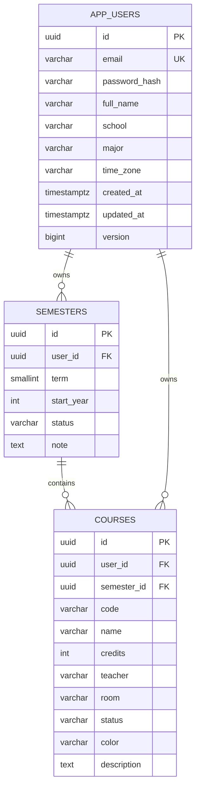
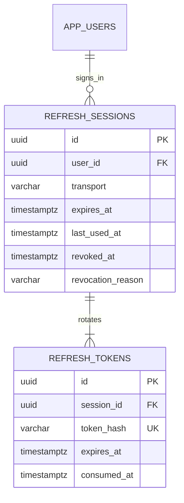
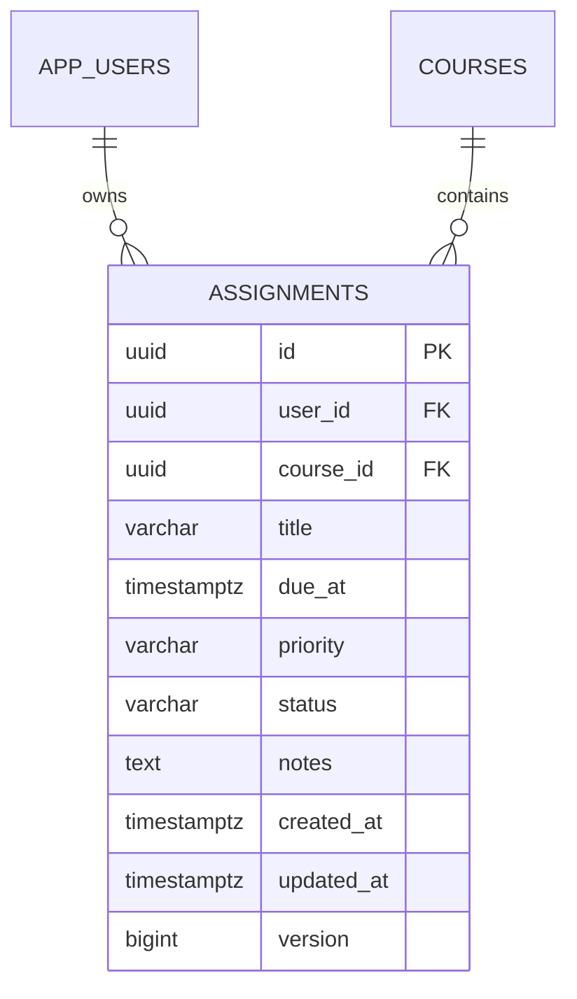

# Database — thiết kế theo từng đợt

## Đã tạo trong V1

Cả ba bảng có UUID, thời điểm tạo/cập nhật và `version`. Dùng timestamp có múi giờ; API xuất thời điểm tuyệt đối bằng UTC. UUID và version hỗ trợ định danh/khóa lạc quan, không thay thế phân quyền.

### Tài khoản

Email lưu dạng trim/lowercase và duy nhất; API đăng ký 2A chuẩn hóa/kiểm tra trước khi ghi, constraint `uq_user_email` chặn cả đăng ký đồng thời. `password_hash` lưu PBKDF2-HMAC-SHA256 với salt riêng và tiền tố phiên bản `{pbkdf2-sha256-v1}`, không có cột mật khẩu rõ. API chỉ trả DTO hồ sơ; không xuất hash. Không tạo tài khoản mẫu. Đợt 2A dùng lại bảng V1, không sửa migration đã áp dụng.

Access token RS256 hạn 15 phút chứa UUID tài khoản `sub`, UUID phiên `sid`, issuer, audience, mốc thời gian, jti và `token_use=access`; không chứa email/mật khẩu. `/users/me` lấy UUID từ token đã xác thực và kiểm tra phiên thuộc đúng tài khoản, không nhận chủ sở hữu từ client. Khóa ký bền vững ngoài Git. V2 bên dưới lưu phiên/refresh; xác minh email/khôi phục mật khẩu là phần sau.

### Học kỳ

- `term`: 1/2 là kỳ chính; 3 là kỳ hè tùy chọn, không tự tạo kỳ hè.
- `start_year`: 2026 biểu diễn năm học 2026–2027; không lưu chuỗi tên kỳ/năm để tránh nhập sai.
- Duy nhất `(user_id, start_year, term)`; hai người có thể có cùng kỳ/năm.
- Tối đa một kỳ `CURRENT` mỗi tài khoản. API 3A đã cập nhật trong cùng transaction: khóa hàng chủ tài khoản, chuyển kỳ CURRENT cũ thành COMPLETED/flush trước khi đánh dấu kỳ mới. PUT/DELETE kiểm tra version; xóa kỳ có môn bị chặn. Không sửa V1/V2; hợp đồng ở `SEMESTERS.md`.
- `CURRENT / UPCOMING / COMPLETED` ánh xạ `Đang học / Sắp tới / Đã kết thúc`.

### Môn học

- Mỗi lần học là một `course.id` riêng; cùng mã môn ở các học kỳ khác nhau vẫn hợp lệ để giữ lịch sử học lại.
- Duy nhất `(semester_id, code)`; mã trim/uppercase. `credits` là số nguyên 1–30, tương ứng form hiện tại.
- Khóa ngoại ghép `(semester_id, user_id)` đảm bảo không gắn môn của người B vào kỳ của người A.
- Trạng thái `STUDYING / COMPLETED / PLANNED`; màu `lavender / mint / peach / blue` theo frontend.
- Chưa có xóa dây chuyền mặc định. Khi thêm bài/lịch/điểm, API phải xử lý liên kết rõ ràng thay vì xóa âm thầm.

API môn 3B đã dùng bảng này: truy vấn theo user_id, kiểm tra học kỳ đích cùng chủ, version khi PUT/DELETE, chuẩn hóa mã/giới hạn trường ở DTO. Ghi môn dùng cùng khóa hàng chủ tài khoản với ghi học kỳ/bài tập; tạo/chuyển môn không đua với xóa kỳ. 4A chặn xóa/chuyển kỳ môn còn bài; lịch/điểm sẽ bổ sung guard khi mở các bảng tương ứng. Không sửa V1/V2 hoặc tự seed dữ liệu; xem `COURSES.md`.

Khóa ngoại này chỉ bảo vệ tính nhất quán quan hệ. Đợt 2/3 vẫn phải lấy user ID từ phiên xác thực, lọc mọi truy vấn theo chủ sở hữu, kiểm tra đọc/ghi chéo hai tài khoản. Chưa có PostgreSQL RLS hoặc API phân quyền hoàn chỉnh ở đợt 1.

## Đã tạo trong V2 — phiên và refresh token

- Mỗi lần đăng nhập tạo một phiên; logout chỉ thu hồi phiên đó, không ảnh hưởng lần đăng nhập khác. `transport` BODY/COOKIE gắn cố định từ lúc tạo.
- Phiên có hạn tuyệt đối 30 ngày. Refresh token có hạn 7 ngày từ lần cấp, luôn bị chặn ở hạn tuyệt đối. Refresh cập nhật last_used_at, không kéo dài hạn phiên.
- Token gốc sinh từ 32 byte SecureRandom, base64url 43 ký tự; chỉ lưu SHA-256 dạng hex 64 ký tự với unique/check constraint. Không lưu mật khẩu/token rõ trong bảng hoặc log.
- Khóa PESSIMISTIC_WRITE trên hàng phiên trước khi đọc trạng thái token. Lookup đầu tiên chỉ lấy projection session ID để tránh giữ bản token cũ trong JPA persistence context.
- Refresh đánh dấu consumed_at, tạo hash token mới trong cùng transaction. Giữ hash đã tiêu thụ để phát hiện replay; replay thu hồi cả phiên, kể cả access token đã phát hành. Thu hồi phải commit dù API trả 401; lỗi database/ký token vẫn rollback.
- revoked_at/revocation_reason có constraint nhất quán; lý do LOGOUT/REPLAY/EXPIRED. Kiểm tra access token truy vấn phiên theo id + user_id + chưa thu hồi + chưa hết hạn.
- Khóa ngoại cascade chỉ trong cụm phiên: xóa tài khoản thì dọn phiên, xóa phiên thì dọn token. Không thay đổi chính sách xóa dữ liệu học tập của V1. Chưa có API xóa tài khoản hoặc job tự dọn phiên hết hạn.
- Cả hai bảng có created_at/updated_at/version như nền tảng. Thời hạn được chuẩn hóa đến microsecond để phản hồi trước/sau đọc PostgreSQL không thay đổi do làm tròn nanosecond.

Chưa lưu danh sách thiết bị/IP/user-agent hoặc tạo giao diện quản lý phiên. Lưu trữ phiên phía client và refresh tự động trên app thuộc 2C; backend chỉ cung cấp cơ chế đã kiểm thử.

## Đã tạo trong V3 — bài tập

- FK ghép `(course_id,user_id)` → `courses(id,user_id)` ngăn liên kết khác chủ; `UNIQUE(id,user_id)` sẵn cho bảng con ở đợt sau. Không cascade xóa.
- `title` tối đa 200, notes tối đa 5000; tên bài có thể trùng. Priority MEDIUM/HIGH; status TODO/IN_PROGRESS/COMPLETED, không dùng status của buổi tự học.
- `due_at` là thời điểm tuyệt đối có giờ/múi giờ, chuẩn hóa UTC/microsecond, trong khoảng [1900-01-01 UTC, 2100-01-01 UTC). Cho phép deadline quá khứ và không tự đổi status.
- Index theo `(user_id,due_at,id)` và `(user_id,course_id)`. API lấy chủ từ JWT, lọc dữ liệu theo chủ; truyền UUID không cấp quyền.
- Bài có version để chống sửa/xóa bản cũ. Môn còn bất kỳ bài nào (kể cả hoàn thành) bị chặn xóa hoặc chuyển kỳ; xóa/chuyển hết bài thì môn cũ được xử lý như 3B.
- Ghi bài/môn/kỳ cùng khóa hàng chủ tài khoản. Không đổi V1/V2; nâng từ V2 giữ nguyên tài khoản/học kỳ/môn. Xem `ASSIGNMENTS.md`.

## Thiết kế cốt lõi cho các migration sau — chưa tạo bảng

| Nhóm | Bảng dự kiến | Quy tắc cần giữ |
| --- | --- | --- |
| Auth bổ sung | verification_tokens, password_reset_tokens | Lưu hash token, hạn dùng/thu hồi; không lưu token/mật khẩu rõ. refresh_sessions/refresh_tokens đã có trong V2. |
| Bài tập bổ sung | assignment_checklist | assignments đã có trong V3, liên kết tự học có ở V4; checklist/tệp làm ở đợt sau. |
| Lịch học bổ sung | Chưa cần bảng mới cho kiểm tra trùng | Chuỗi có ở V5, ngoại lệ ở V6; 4E.2B xét lịch hiệu lực sau ngoại lệ trong service. |
| Lịch thi | exams | Gắn môn/người; ngày thi và giờ bắt đầu/kết thúc, hình thức, phòng, ghi chú; kiểm tra trùng với lịch học/tự học. |
| Điểm, đợt 5 | course_grade_configs, grade_columns, grade_project_allocations | Cột có thể thêm/xóa/đổi tên/đổi loại; score nullable, 0 khác chưa nhập; cấu hình vai trò/tỷ lệ BTL rõ; lưu phiên bản quy tắc. |
| Pomodoro | pomodoro_sessions (V10/V11), pomodoro_preferences (V11) | Phiên thực tế, trạng thái kết thúc và snapshot; lịch sử/tiến độ từ phiên COMPLETED, mục tiêu theo tài khoản có version. |
| Thông báo | reminder_preferences, notification_receipts, delivery_jobs | Lưu phiên bản nội dung đã đọc; lịch gửi/hủy/cập nhật riêng với danh sách trong app; không coi nhắc trong app là đã gửi push. |
| Tệp/AI | attachments, ai_plans, ai_plan_items | Quyền truy cập tệp, nguồn/trang, draft/preview/approved; chỉ ghi lịch sau khi duyệt và kiểm tra lại xung đột. |

Các bảng con dùng composite FK `(parent_id, user_id)` khi có chủ sở hữu. Bài tập/lịch/buổi học tra theo ID, không theo tên môn. GPA và thống kê được tính từ nguồn, chưa tạo bảng chứa số tổng hợp dễ lệch dữ liệu. Cần chốt thêm snapshot và quy tắc học lại trước migration điểm.

## Đã tạo trong V4 — kế hoạch tự học

Bảng `study_sessions` lưu buổi lên kế hoạch, tách với lịch sử Pomodoro sẽ làm sau. Tài khoản/phiên/kỳ/môn/bài cũ giữ nguyên; không seed dữ liệu tự học mẫu.

| Cột | Dữ liệu |
| --- | --- |
| id / user_id / course_id | UUID buổi, chủ tài khoản và môn; môn/chủ bắt buộc. |
| assignment_id | UUID bài tùy chọn; null là độc lập. |
| title / notes | Nội dung tối đa 200, ghi chú tối đa 5000. |
| starts_at / ends_at | TIMESTAMPTZ; ends_at = starts_at + duration_minutes. |
| time_zone | Tên múi giờ cho ngày của buổi và giới hạn trước 24:00. |
| duration_minutes | Số nguyên 1–240. |
| status | PLANNED / IN_PROGRESS / COMPLETED. |
| created_at / updated_at / version | Thời điểm tạo/cập nhật và khóa phiên bản. |

- FK `(course_id,user_id)` → courses; FK `(assignment_id,user_id,course_id)` → assignments ngăn bài khác chủ hoặc khác môn. V4 thêm UNIQUE tương ứng cho assignments, không thay dữ liệu V3.
- Link bài nullable dùng MATCH SIMPLE mặc định; khóa môn/chủ riêng vẫn kiểm tra khi assignmentId null. Không cascade xóa kế hoạch.
- CHECK bảo vệ thời lượng/khoảng năm, end tính đúng, phút nguyên, cùng ngày theo time_zone, tiêu đề/trạng thái/ghi chú/version; index theo owner/time, owner/course và owner/assignment.
- API dùng chung khóa hàng chủ tài khoản cho mọi ghi học kỳ/môn/bài/tự học, kiểm tra trùng thời gian và hạn trước commit. Quy tắc trùng/deadline liên bảng nằm trong service, không dùng CHECK truy vấn bảng khác. SQL ngoài API có thể bỏ qua hai quy tắc liên bảng này.
- Xóa bài cập nhật từng buổi thành độc lập, flush để tăng version rồi mới xóa bài trong cùng giao dịch. Môn còn bất kỳ buổi nào chặn xóa/chuyển kỳ. Sửa/xóa buổi dùng owner/version; không nhận userId hoặc focusedSeconds từ client.
- 4D đã nối UI tự học; V5 có chuỗi lịch, ngoại lệ/trùng giờ và UI lịch tiếp tục 4E.2/4F. Lịch thi/Pomodoro còn các đợt sau. Chi tiết ở `STUDY-SESSIONS.md`.

## Migration

Flyway là nơi duy nhất tạo/đổi schema. Đã có V1 nền tảng, V2 phiên, V3 bài tập, V4 tự học, V5 lịch lặp và V6 ngoại lệ; đợt sau thêm V7 trở đi. Không sửa các migration đã áp dụng hoặc bật `ddl-auto=update` để sửa ngầm. `flyway.clean` bị khóa. Hibernate `validate` kiểm tra mapping khi khởi động; lỗi migration/schema làm app dừng thay vì chạy trên database sai.

## Đã tạo trong V5 — chuỗi lịch học

`class_schedules` lưu một hàng cho mỗi chuỗi; API tính occurrence khi đọc, không nhân bản hàng theo ngày. Giữ dữ liệu V1–V4, không seed. FK `(course_id,user_id)` → courses và UNIQUE `(id,user_id)` bảo vệ chủ sở hữu/chuẩn bị ngoại lệ.

- `weekday_mask` integer 1–127: 7 bit cho ISO thứ Hai đến Chủ nhật. Contract trả danh sách `weekdays` 1–7; không lộ mask. Không tạo bảng weekdays riêng cho tập cố định 7 thứ.
- `starts_on/ends_on` DATE gồm cả hai đầu, năm 1900–2099, tối đa 366 ngày. `start_time/end_time` TIME không có offset: phút nguyên, tăng trong cùng ngày; `time_zone` xác định offset cho mỗi ngày, tránh cố định UTC qua DST.
- `room/teacher/notes`, `reminder_minutes` 0–10080, `created_at/updated_at/version` lưu cùng chuỗi. Mốc nhắc chưa tạo job hoặc gửi thông báo.
- CHECK bảo vệ mask/khoảng ngày/giờ/notes/reminder/version; API kiểm tra trúng thứ, zone và giờ DST không rõ. Index owner/date và owner/course. SQL ngoài API có thể bỏ qua các quy tắc service.
- Ghi chuỗi cùng khóa tài khoản với môn/kỳ/bài/tự học; môn còn lịch chặn xóa/chuyển kỳ. Sửa/xóa rule kiểm tra owner/version trước commit.
- 4E.1 chưa có ngoại lệ hoặc kiểm tra trùng; 4E.2 bổ sung các guard hai chiều rồi 4F nối UI. Contract: `CLASS-SCHEDULES.md`.

## Đã tạo trong V6 — ngoại lệ từng buổi

- `class_exceptions`: UUID, user_id, schedule_id, occurrence_date, kind CANCELLED/CHANGED, start_time/end_time/room/teacher nullable, reason tối đa 1000, timestamps/version nội bộ. Null nghĩa là kế thừa chuỗi; chuỗi rỗng ở phòng/giảng viên là ghi đè thành trống.
- UNIQUE `(schedule_id,occurrence_date)`; FK `(schedule_id,user_id)` → class_schedules bảo vệ chủ sở hữu và cascade chỉ khi xóa cả chuỗi. CHECK bảo vệ kind, dữ liệu buổi nghỉ/đổi, giờ phút/trước 24:00, thứ tự giờ khi đủ hai đầu, khoảng năm và version. API kiểm tra ngày thuộc chuỗi và thời gian sau kế thừa/DST.
- `class_schedules.exception_revision` mặc định 0, không đổi version cũ khi migrate. Mỗi ghi/khôi phục ngoại lệ làm dirty counter để @Version chuỗi tăng; counter không lộ DTO. Client luôn kiểm tra version cả chuỗi, tránh bản cũ ghi lại sau khi ngoại lệ được khôi phục/tạo lại.
- Ghi dùng khóa hàng tài khoản chung; parent version và child data commit nguyên tử. GET ngoại lệ/occurrences dùng snapshot REPEATABLE_READ, query ngoại lệ theo lô.
- Sửa chuỗi không được bỏ ngày đang có ngoại lệ, làm giờ hiệu lực sai hoặc chuyển môn khi còn ngoại lệ. Khôi phục ngoại lệ trước các thay đổi đó. Không có bảng occurrence materialized.
- 4E.2B đã kiểm tra trùng lịch–lịch/tự học hai chiều, dùng lịch hiệu lực và bỏ buổi nghỉ khi xét giờ bận; không thêm bảng/migration, vẫn V6. 4F nối UI. Chi tiết: `CLASS-EXCEPTIONS.md`.

## Đã tạo trong V7 — lịch thi

`exams` lưu UUID/owner/course, kind/format, starts_at/ends_at TIMESTAMPTZ UTC, time_zone, room, reminder, reminder_minutes INTEGER[], notes và timestamps/version. FK `(course_id,user_id)` → courses, không cascade xóa môn. Index owner/time và owner/course.

CHECK bảo vệ enum, khoảng năm, thứ tự giờ, phút nguyên và cùng ngày địa phương, độ dài notes/version. Hàm `exam_reminders_valid` kiểm tra mảng một chiều bắt đầu từ 1, tối đa 10 mốc riêng biệt 0–10080 và không có phần tử null; CHECK giữ mảng rỗng khi tắt nhắc và không rỗng khi bật. Java normalize mốc giảm dần.

`update_revision` nội bộ làm bản ghi dirty cho mọi PUT, kể cả nội dung giống hệt; @Version tăng một lần, không trả counter ra client. V7 không sửa V1–V6, không seed. Ghi lịch thi cùng khóa tài khoản với các nghiệp vụ học tập; môn còn lịch thi chặn xóa/chuyển kỳ. Chi tiết `EXAMS.md`. Kiểm tra trùng thuộc 4H.1B; UI thuộc 4H.2.

## Đã tạo trong V10 — phiên Pomodoro thực tế

`pomodoro_sessions` lưu user FK, client_request_id, status RUNNING/PAUSED, duration_seconds=1500; started_at/state_changed_at/run_started_at UTC và elapsed_millis/paused_millis BIGINT, time_zone, version/timestamps. Snapshot course/code/name, semester/term/year, assignment/title và study/title được kiểm tra theo tài khoản khi tạo; không có FK tới nguồn học tập để giữ lịch sử sau đổi/xóa nguồn.

UNIQUE `(user_id,client_request_id)` chống Start trùng; partial unique index theo user_id ở RUNNING/PAUSED giữ một phiên hoạt động, kể cả đã hết giờ. CHECK bảo vệ trạng thái, thời gian không âm/có giới hạn, anchor RUNNING/PAUSED, snapshot và version. Ghi dùng cùng khóa tài khoản như các nghiệp vụ học tập. GET tính thời gian theo anchor nhưng không UPDATE/tự hoàn tất.

V10 chỉ thêm bảng/index, giữ nguyên dữ liệu V1–V9, không seed. Lịch sử hoàn tất/hủy và mục tiêu ở 6A.2, giao diện ở 6B; xem [POMODORO.md](POMODORO.md).

## Đã tạo trong V11 — kết thúc Pomodoro và mục tiêu ngày

Thêm ended_at/finalized_at nullable vào pomodoro_sessions; giữ nguyên phiên V10. Cho phép COMPLETED/CANCELLED, CHECK yêu cầu đủ thời lượng cho COMPLETED, thời lượng chưa đủ cho CANCELLED, mốc kết thúc/xác nhận và anchor đúng trạng thái. Partial unique index phiên hoạt động V10 vẫn áp dụng; index owner/ended_at/id hỗ trợ lịch sử terminal. GET không tự hoàn tất; các lệnh versioned ghi trạng thái và thời gian nguyên tử, terminal giữ nguyên sau đó.

pomodoro_preferences có UUID, user_id FK/UNIQUE, daily_sessions SMALLINT 1–12, timestamps và version. Không seed: mặc định 4/version API 0 khi chưa có row; lần lưu đầu version API 1, sau đó tăng khi thay đổi (version API là version ORM + 1). Khóa tài khoản bảo vệ cả trường hợp chưa có row, chống hai lần ghi đầu cùng version 0. GET default không INSERT; cùng giá trị/version hiện tại là no-op.

Lịch sử/tiến độ được đọc từ các phiên, không có bảng tổng đếm cộng dồn nên gửi lặp không cộng trùng. COMPLETED công nhận đủ thời lượng; CANCELLED giữ phần học dở nhưng công nhận 0. Ngày xét theo ended_at và múi giờ query, không theo finalized_at. Xem [POMODORO.md](POMODORO.md).
