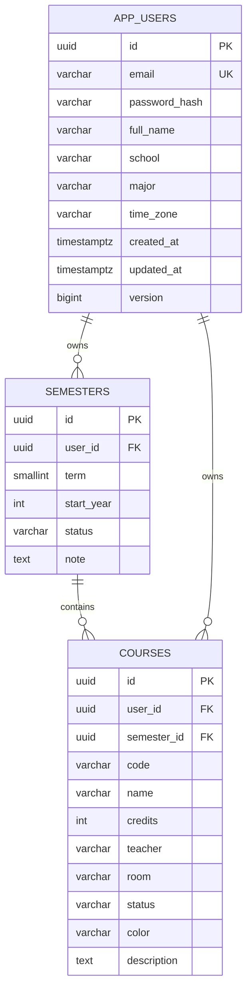
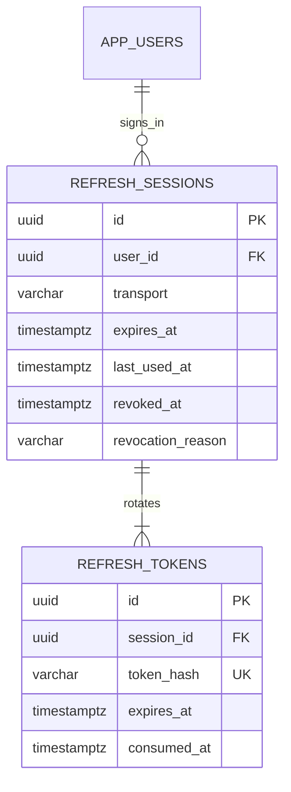

# Database — thiết kế theo từng đợt

## Đã tạo trong V1

Cả ba bảng có UUID, thời điểm tạo/cập nhật và `version`. Dùng timestamp có múi giờ; API xuất thời điểm tuyệt đối bằng UTC. UUID và version hỗ trợ định danh/khóa lạc quan, không thay thế phân quyền.

### Tài khoản

Email lưu dạng trim/lowercase và duy nhất; API đăng ký 2A chuẩn hóa/kiểm tra trước khi ghi, constraint `uq_user_email` chặn cả đăng ký đồng thời. `password_hash` lưu PBKDF2-HMAC-SHA256 với salt riêng và tiền tố phiên bản `{pbkdf2-sha256-v1}`, không có cột mật khẩu rõ. API chỉ trả DTO hồ sơ; không xuất hash. Không tạo tài khoản mẫu. Đợt 2A dùng lại bảng V1, không sửa migration đã áp dụng.

Access token RS256 hạn 15 phút chứa UUID tài khoản `sub`, UUID phiên `sid`, issuer, audience, mốc thời gian, jti và `token_use=access`; không chứa email/mật khẩu. `/users/me` lấy UUID từ token đã xác thực và kiểm tra phiên thuộc đúng tài khoản, không nhận chủ sở hữu từ client. Khóa ký bền vững ngoài Git. V2 bên dưới lưu phiên/refresh; xác minh email/khôi phục mật khẩu là phần sau.

### Học kỳ

- `term`: 1/2 là kỳ chính; 3 là kỳ hè tùy chọn, không tự tạo kỳ hè.
- `start_year`: 2026 biểu diễn năm học 2026–2027; không lưu chuỗi tên kỳ/năm để tránh nhập sai.
- Duy nhất `(user_id, start_year, term)`; hai người có thể có cùng kỳ/năm.
- Tối đa một kỳ `CURRENT` mỗi tài khoản. API 3A đã cập nhật trong cùng transaction: khóa hàng chủ tài khoản, chuyển kỳ CURRENT cũ thành COMPLETED/flush trước khi đánh dấu kỳ mới. PUT/DELETE kiểm tra version; xóa kỳ có môn bị chặn. Không sửa V1/V2; hợp đồng ở `SEMESTERS.md`.
- `CURRENT / UPCOMING / COMPLETED` ánh xạ `Đang học / Sắp tới / Đã kết thúc`.

### Môn học

- Mỗi lần học là một `course.id` riêng; cùng mã môn ở các học kỳ khác nhau vẫn hợp lệ để giữ lịch sử học lại.
- Duy nhất `(semester_id, code)`; mã trim/uppercase. `credits` là số nguyên 1–30, tương ứng form hiện tại.
- Khóa ngoại ghép `(semester_id, user_id)` đảm bảo không gắn môn của người B vào kỳ của người A.
- Trạng thái `STUDYING / COMPLETED / PLANNED`; màu `lavender / mint / peach / blue` theo frontend.
- Chưa có xóa dây chuyền mặc định. Khi thêm bài/lịch/điểm, API phải xử lý liên kết rõ ràng thay vì xóa âm thầm.

Khóa ngoại này chỉ bảo vệ tính nhất quán quan hệ. Đợt 2/3 vẫn phải lấy user ID từ phiên xác thực, lọc mọi truy vấn theo chủ sở hữu, kiểm tra đọc/ghi chéo hai tài khoản. Chưa có PostgreSQL RLS hoặc API phân quyền hoàn chỉnh ở đợt 1.

## Đã tạo trong V2 — phiên và refresh token

- Mỗi lần đăng nhập tạo một phiên; logout chỉ thu hồi phiên đó, không ảnh hưởng lần đăng nhập khác. `transport` BODY/COOKIE gắn cố định từ lúc tạo.
- Phiên có hạn tuyệt đối 30 ngày. Refresh token có hạn 7 ngày từ lần cấp, luôn bị chặn ở hạn tuyệt đối. Refresh cập nhật last_used_at, không kéo dài hạn phiên.
- Token gốc sinh từ 32 byte SecureRandom, base64url 43 ký tự; chỉ lưu SHA-256 dạng hex 64 ký tự với unique/check constraint. Không lưu mật khẩu/token rõ trong bảng hoặc log.
- Khóa PESSIMISTIC_WRITE trên hàng phiên trước khi đọc trạng thái token. Lookup đầu tiên chỉ lấy projection session ID để tránh giữ bản token cũ trong JPA persistence context.
- Refresh đánh dấu consumed_at, tạo hash token mới trong cùng transaction. Giữ hash đã tiêu thụ để phát hiện replay; replay thu hồi cả phiên, kể cả access token đã phát hành. Thu hồi phải commit dù API trả 401; lỗi database/ký token vẫn rollback.
- revoked_at/revocation_reason có constraint nhất quán; lý do LOGOUT/REPLAY/EXPIRED. Kiểm tra access token truy vấn phiên theo id + user_id + chưa thu hồi + chưa hết hạn.
- Khóa ngoại cascade chỉ trong cụm phiên: xóa tài khoản thì dọn phiên, xóa phiên thì dọn token. Không thay đổi chính sách xóa dữ liệu học tập của V1. Chưa có API xóa tài khoản hoặc job tự dọn phiên hết hạn.
- Cả hai bảng có created_at/updated_at/version như nền tảng. Thời hạn được chuẩn hóa đến microsecond để phản hồi trước/sau đọc PostgreSQL không thay đổi do làm tròn nanosecond.

Chưa lưu danh sách thiết bị/IP/user-agent hoặc tạo giao diện quản lý phiên. Lưu trữ phiên phía client và refresh tự động trên app thuộc 2C; backend chỉ cung cấp cơ chế đã kiểm thử.

## Thiết kế cốt lõi cho các migration sau — chưa tạo bảng

| Nhóm | Bảng dự kiến | Quy tắc cần giữ |
| --- | --- | --- |
| Auth bổ sung | verification_tokens, password_reset_tokens | Lưu hash token, hạn dùng/thu hồi; không lưu token/mật khẩu rõ. refresh_sessions/refresh_tokens đã có trong V2. |
| Bài tập, đợt 4 | assignments, assignment_checklist | Gắn `course_id + user_id`; deadline là thời điểm có giờ/múi giờ; trạng thái riêng với buổi tự học. |
| Lịch học | class_series, class_series_weekdays, class_exceptions | Chuỗi có ngày bắt đầu/kết thúc và múi giờ; ngoại lệ duy nhất `(series_id, date)` cho đổi/nghỉ một buổi; phát hiện trùng ở service. |
| Lịch thi | exams | Gắn môn/người; ngày thi và giờ bắt đầu/kết thúc, hình thức, phòng, ghi chú; kiểm tra trùng với lịch học/tự học. |
| Tự học | study_sessions | Gắn môn, liên kết bài tùy chọn; một bài có nhiều buổi; thời điểm/thời lượng/trạng thái độc lập. |
| Điểm, đợt 5 | course_grade_configs, grade_columns, grade_project_allocations | Cột có thể thêm/xóa/đổi tên/đổi loại; score nullable, 0 khác chưa nhập; cấu hình vai trò/tỷ lệ BTL rõ; lưu phiên bản quy tắc. |
| Pomodoro | focus_records, focus_preferences | Định danh phiên để không ghi trùng; mốc bắt đầu/kết thúc/tạm dừng, thời gian học thực; lưu snapshot môn/học kỳ. |
| Thông báo | reminder_preferences, notification_receipts, delivery_jobs | Lưu phiên bản nội dung đã đọc; lịch gửi/hủy/cập nhật riêng với danh sách trong app; không coi nhắc trong app là đã gửi push. |
| Tệp/AI | attachments, ai_plans, ai_plan_items | Quyền truy cập tệp, nguồn/trang, draft/preview/approved; chỉ ghi lịch sau khi duyệt và kiểm tra lại xung đột. |

Các bảng con dùng composite FK `(parent_id, user_id)` khi có chủ sở hữu. Bài tập/lịch/buổi học tra theo ID, không theo tên môn. GPA và thống kê được tính từ nguồn, chưa tạo bảng chứa số tổng hợp dễ lệch dữ liệu. Cần chốt thêm snapshot và quy tắc học lại trước migration điểm.

## Migration

Flyway là nơi duy nhất tạo/đổi schema, tên `V2__...sql`, `V3__...sql` cho các đợt tiếp theo. Không sửa V1 sau khi đã áp dụng hoặc bật `ddl-auto=update` để sửa ngầm. `flyway.clean` bị khóa. Hibernate `validate` kiểm tra mapping khi khởi động; lỗi migration/schema làm app dừng thay vì chạy trên database sai.
