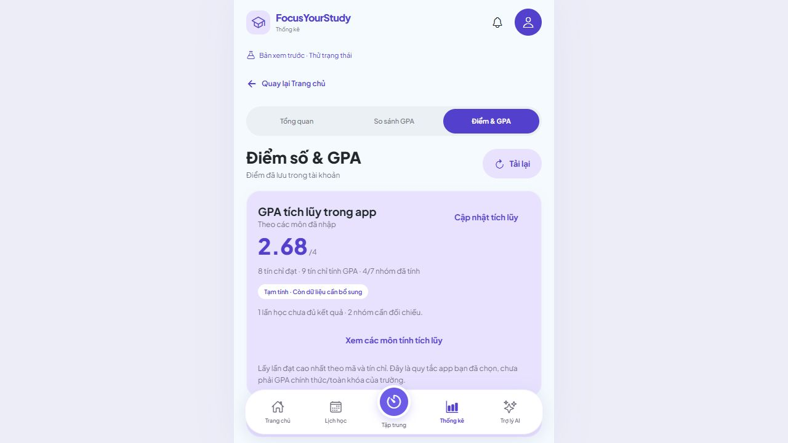
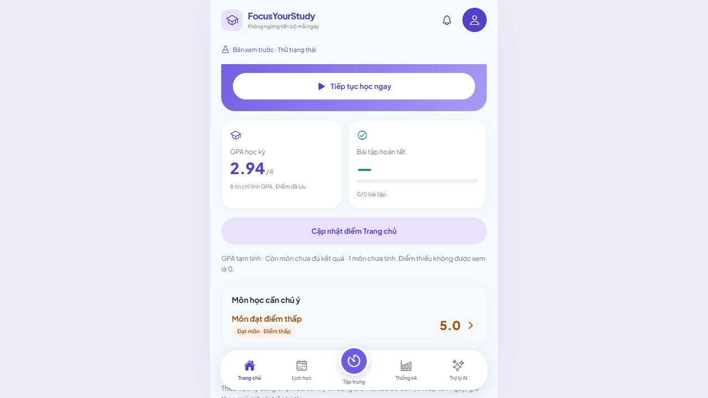
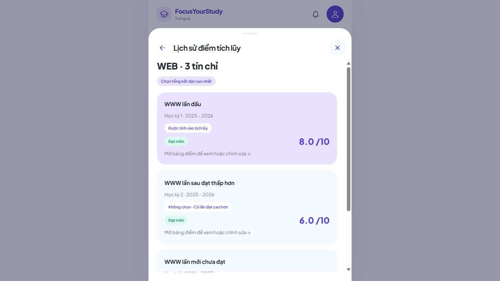

# 5C.3 — GPA tích lũy, so sánh học kỳ và Dashboard

Hoàn tất kiểm tra trên web ngày 28/10/2026. Project: `D:\Video OBS\QuanLyHocTap`.

## Đã làm

- **Thống kê → Điểm & GPA:** GPA tích lũy đọc từ `GET /api/v1/gpa/cumulative`. Bấm **Xem các môn tính tích lũy**, mở từng nhóm để xem các lần học, điểm được chọn và lý do không chọn các lần còn lại; có thể mở chi tiết để nhập/sửa điểm.
- **Thống kê → So sánh GPA:** chọn hai học kỳ khác nhau, đổi chỗ A/B, xem GPA và tín chỉ của từng kỳ; mở bảng điểm đúng kỳ để xem/sửa môn. Chênh lệch là **GPA B − GPA A**; không lấy trung bình GPA hai kỳ để tính tích lũy. Mỗi kỳ là một snapshot độc lập từ API GPA học kỳ.
- **Trang chủ:** GPA của học kỳ đang chọn và cảnh báo môn lấy kết quả backend. Môn đạt có tổng kết ≤ 5 hiển thị cam; môn rớt/chặn thi hiển thị đỏ. Bấm thẻ GPA mở đúng bảng điểm học kỳ; bấm cảnh báo mở đúng môn.
- Sau lưu điểm/cấu hình, đổi học kỳ, quay lại màn hoặc tải lại dữ liệu, số liệu được đọc lại từ API. Có tải/lỗi/thử lại/trống; lỗi không biến thành GPA 0 hoặc tiếp tục hiển thị GPA cũ như kết quả mới.
- Chống phản hồi về muộn và đối chiếu phiên bản danh mục học kỳ/môn; không dùng GPA RAM để hiển thị trong tài khoản thật. Dữ liệu mẫu vẫn có luồng thử riêng.

## Chính sách tích lũy đang áp dụng

Backend thực hiện chính sách app đã được người dùng chọn: trong nhóm cùng mã/tín chỉ, lấy **tổng kết đạt cao nhất**; bằng điểm chọn năm/kỳ gần nhất. Chưa có lần đạt thì lấy lần F hoàn chỉnh gần nhất, hệ 4 bằng 0 và vẫn tính tín chỉ vào mẫu số. Mỗi nhóm tính tín chỉ một lần; các lần học cũ vẫn hiện trong lịch sử.

Điểm chưa đủ không thành 0. Nhóm khác tín chỉ hoặc cần đối chiếu không tự gộp vào phép tính; giao diện hiện lý do và số nhóm cần xử lý. Khi còn thiếu dữ liệu, kết quả được ghi là chưa đầy đủ.

Đây là **GPA trong phạm vi dữ liệu và chính sách app**, chưa được coi là GPA chính thức toàn khóa IUH. Xác minh quy tắc học cải thiện/hủy/phục hồi, P/không tính GPA, miễn/chuyển điểm vẫn nằm trong checklist để sau. Không đổi công thức backend trong đợt này.

## Cách tự kiểm tra một vòng

Chạy backend và frontend như trước. Dùng **tài khoản test riêng**, chỉ có các môn dưới đây để các số kỳ vọng không bị ảnh hưởng bởi dữ liệu khác. Không cần thêm seed vào database đang sử dụng.

1. Tạo **học kỳ A: HK1 năm 2025–2026** và **học kỳ B: HK2 năm 2025–2026**; chọn B làm kỳ hiện tại.
2. Mỗi kỳ thêm một môn mã **QA-WEB**, cùng **3 tín chỉ**, loại **Lý thuyết**. Dùng bộ cột thường kỳ/giữa kỳ/cuối kỳ được đề xuất, không thêm BTL.
3. Ở kỳ A nhập cả ba điểm **8**; ở kỳ B nhập cả ba điểm **6**, lưu từng môn.
4. Vào **Điểm & GPA**: GPA tích lũy phải **3,50/4**, tín chỉ tính GPA **3**, không phải 6. Mở nhóm QA-WEB: lần 8 được chọn, lần 6 vẫn hiện và có lý do không chọn.
5. Vào **So sánh GPA**, chọn A/B: A **3,50**, B **2,50**, chênh lệch **−1,00**. Đổi chỗ phải thành **+1,00**; không chọn cùng một kỳ cho cả hai ô.
6. Từ bảng điểm kỳ B, mở QA-WEB, đổi cả ba điểm thành **9**, lưu và quay lại: B **4,00**, tích lũy **4,00**, lần B được chọn; với A/B như bước 5, chênh lệch **+0,50**. Trang chủ đang chọn B cũng hiện **4,00**. F5 rồi kiểm tra lại.
7. Xóa riêng điểm giữa kỳ của B và lưu: B không đủ điểm để có GPA; tích lũy vẫn có thể dùng lần A đạt 8 và phải báo còn dữ liệu chưa đủ. Điểm trống không thành F hoặc 0.
8. Nhập cả ba điểm B thành **1**: GPA kỳ B **0,00**; tích lũy vẫn chọn A đạt 8, lần F của B không biến mất. Sau đó đổi cả ba điểm A thành **1**: tích lũy **0,00**, vẫn có **3 tín chỉ tính GPA**, không hiện dấu trống.
9. Nếu muốn thử đối chiếu, thêm cùng mã mới ở hai kỳ nhưng khác tín chỉ. Nhóm phải có cảnh báo và không tự cộng vào tích lũy; mở lịch sử xem lý do.
10. Tắt backend trong terminal thử nghiệm, bấm cập nhật điểm: hiện lỗi và không giữ GPA cũ như số liệu vừa tải thành công. Chạy lại backend rồi thử lại, điểm đã lưu vẫn còn.
11. Đăng xuất, đăng nhập tài khoản khác: không còn các môn/GPA tài khoản trước. Tài khoản trống phải hiện trạng thái trống; tài khoản chỉ có một kỳ vẫn xem GPA kỳ đó nhưng chưa có chênh lệch hai kỳ.

F5 giữ dữ liệu đã lưu; lựa chọn cặp A/B có thể trở về mặc định, cần chọn lại khi so sánh.

## Bằng chứng đã kiểm tra

Dùng schema PostgreSQL QA riêng và tài khoản giả, không seed tài khoản người dùng:

| Trường hợp | Kết quả quan sát |
| --- | --- |
| Cùng môn có các lần 8, 6 và F | Chọn 8; giữ đủ lịch sử và lý do chọn/bỏ. |
| Sửa lần gần nhất thành 9 qua trình nhập điểm trên web | GPA kỳ hiện tại 1,44 → 2,94; tích lũy 2,51 → 2,68, chuyển sang chọn lần 9. |
| So sánh hai kỳ mặc định sau sửa | 2,79 và 2,94, chênh lệch +0,15; đổi chỗ đảo dấu. |
| Thiếu điểm và hai nhóm cần đối chiếu tín chỉ | Có nhãn chưa đầy đủ, nhóm cần đối chiếu không tự tính vào tích lũy. |
| F5, mở bảng điểm từ Dashboard, sửa rồi quay lại | Các màn đọc cùng kết quả đã lưu, mở đúng kỳ/môn. |
| Tắt/khởi động lại backend QA | Lỗi ẩn số cũ; thử lại khôi phục đúng số liệu. |
| Tài khoản B trống, sau đó chỉ có một môn F 1 tín chỉ | Không thấy môn A; tích lũy và Dashboard 0,00, tín chỉ tính GPA 1, chưa có so sánh hai kỳ. |
| Đăng xuất và mở dữ liệu mẫu | Luồng so sánh mẫu vẫn hoạt động riêng. |

**TypeScript, export web và 403 tests frontend đạt**, không lỗi/bỏ qua; gồm **29 test mới**, tổng **124 test phần điểm**. Test mới kiểm tra hợp đồng tích lũy, quyền/phạm vi danh mục, phiên bản, lịch sử/decisions, null khác 0, query/abort và phản hồi cũ. Fixture JSON lấy từ dữ liệu QA giả, không chứa thông tin đăng nhập.

Không đổi backend/schema/dependency. Mốc **537 tests backend** là kết quả đã có ở đợt trước, không chạy lại toàn bộ trong 5C.3. API/PostgreSQL và trình duyệt QA đã kiểm tra trực tiếp; schema/tiến trình QA riêng được dọn sau nghiệm thu. PostgreSQL dùng chung được giữ chạy.

Thiết bị thật vẫn để sau theo **2C.3B**; test web không xác nhận hành vi native. Pomodoro/thống kê thời gian học vẫn chờ kết nối backend.

## Ảnh nghiệm thu







## Tên commit và push

```powershell
cd 'D:\Video OBS\QuanLyHocTap'
git add .
git commit -m "Đồng bộ GPA tích lũy, so sánh và Dashboard qua API"
git push origin main
```

Chưa tự commit hoặc push.
