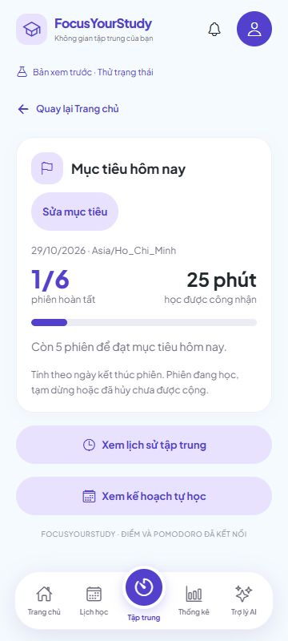
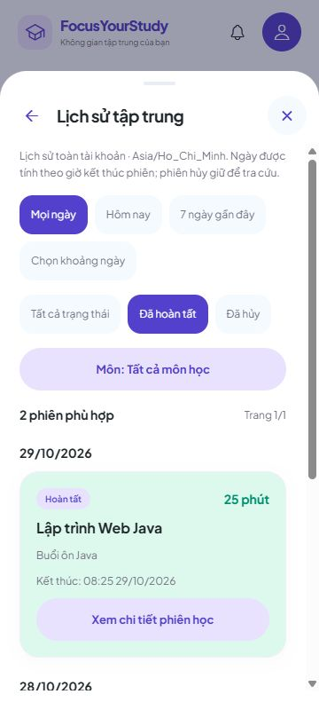

# 6B.3 — Nghiệm thu Pomodoro trên web

Đã nghiệm thu bằng thao tác thật trên trình duyệt ngày 29/10/2026, dùng backend Spring Boot và PostgreSQL trong schema QA biệt lập. Không dùng tài khoản hoặc dữ liệu học tập chính để kiểm tra. Không thêm backend, migration hoặc dependency.

## Những lỗi đã sửa

- Thẻ mục tiêu trên màn hình 360px: nút **Sửa mục tiêu** không còn tràn ra ngoài thẻ.
- Các lựa chọn mục tiêu và bộ lọc có `aria-checked`; thanh tiến độ có giá trị min/max/now để công cụ trợ năng đọc đúng.
- Tải lại trang không tự mở hồ sơ che màn hình. Có thể mở Hồ sơ bằng nút trên thanh đầu trang.
- Sửa nhãn cũ ở hồ sơ, thông báo đồng bộ và chân trang: Pomodoro tài khoản đã lưu thật, không còn ghi là chỉ dùng thử trong phiên.
- Giữ yêu cầu chỉnh mục tiêu khi gặp 409 để GET đối chiếu. Trong thử nghiệm, trình duyệt tự gửi lại PUT sau khi mất phản hồi; lần đầu đã commit nhưng lần gửi lại bị chặn bằng version. Không được suy từ 409 rằng lần đầu chưa lưu. Nếu GET thấy đúng giá trị đang chờ, xác nhận kết quả; nếu khác, giữ draft để người dùng xem và chọn lại.

Đã bổ sung test hồi quy cho trường hợp PUT đã commit rồi trả 409 do thử lại ở tầng truyền tải. Ứng dụng không tự đổi version để ghi đè; việc trình duyệt có thể gửi lại HTTP được backend bảo vệ bằng version/idempotency.

## Kết quả kiểm tra giao diện

| Nhóm | Đã quan sát được trên UI |
| --- | --- |
| Dữ liệu mới | Mục tiêu mặc định `0/4`, `0 phút`, lịch sử trống; không có phiên mẫu trong tài khoản thật. |
| Lưu mục tiêu | Đổi sang 6, F5 vẫn `0/6`; chỉ đổi mục tiêu, không tự tạo phiên. |
| Tạm dừng và F5 | Thời gian `24:55` trước và sau F5 bằng nhau; tiếp tục cùng phiên. |
| Đang chạy và F5 | Không trở lại 25 phút; vẫn giữ tên **Buổi ôn Java** theo snapshot dù lựa chọn nháp đã được đặt lại. |
| Hai tab và mục tiêu | Tab A giữ lựa chọn 5, tab B lưu 8; A bị chặn ghi đè và giữ lựa chọn. Đọc/nạp mục tiêu mới rồi chọn lại để lưu. |
| Xác nhận hủy cũ | Mở bảng hủy ở A, tiếp tục phiên ở B: A báo phiên thay đổi và khóa nút xác nhận cũ. |
| Phiên hủy | Có trong lịch sử, hiện thời gian học dở; số phút/phiên hoàn tất giữ nguyên. |
| Hoàn tất | UI công nhận đúng `1/6 · 25 phút`; F5 không tăng thêm. Chi tiết giữ đúng môn, bài tập và buổi tự học. |
| Phân trang | Bộ 11 phiên chia trang đầu 10, trang sau 1; đổi bộ lọc về trang đầu. Sau các thử lỗi mạng có 13 phiên, vẫn chỉ 25 phút hoàn tất trong ngày. |
| Bộ lọc | Lọc được hoàn tất/hủy, môn Java/React, hôm nay/7 ngày/khoảng ngày bằng lịch. Ngày 28/10 chỉ có phiên kết thúc 23:59 hôm đó; không lẫn phiên ngày 29/10. |
| Ngày không hợp lệ | Chọn từ 30/10 đến 28/10 bị báo lỗi; khoảng đã áp dụng trước đó được giữ. |
| Mất phản hồi mục tiêu | Server lưu 9 nhưng phản hồi thành công bị ngắt, trình duyệt gửi lại gặp 409: UI giữ lựa chọn 9 và thông tin đối chiếu. GET xác nhận được mục tiêu đã lưu; không cần PUT mới để xác nhận. |
| Start chưa rõ kết quả | Proxy trả 502 sau khi Start đã commit, tạm ngắt luồng đọc: UI khóa tạo phiên mới và giữ yêu cầu qua F5. Mở lại luồng đọc, GET tìm đúng phiên đã tạo; số POST Start không tăng khi đối chiếu. |
| Backend tạm ngắt/khởi động lại | Lịch sử/tiến độ báo lỗi, không biến lỗi thành 0 phiên. F5 có màn chưa kiểm tra được đăng nhập và nút khôi phục. Sau khi dịch vụ chạy lại, mở lại trang tự khôi phục A và giữ `1/6 · 25 phút`, đủ 13 phiên. |
| Hai tài khoản | A → B: B có `0/4 · 0 phút`, môn riêng và lịch sử trống. B → A: A trở lại `1/6 · 25 phút`. |
| Bố cục và trợ năng | Kiểm tra desktop và 360×800; thẻ mục tiêu/nút mở lịch sử và bảng chọn không tràn. Radio đã chọn và giá trị tiến độ xuất hiện đúng trong cây truy cập. |

Để không phải chờ 25 phút mỗi lần, trường hợp hết giờ dùng timestamp được điều chỉnh **chỉ trong schema QA**. API sản phẩm không có nút ép hoàn tất và đồng hồ máy không bị thay đổi. Thử lỗi dùng proxy chỉ trên loopback: một lần ngắt phản hồi sau commit, một lần mô phỏng gateway 502; các dịch vụ QA được dọn sau nghiệm thu.

## Ảnh từ bản QA

## Bạn kiểm tra nhanh trên project chính

Giữ backend chạy bằng `backend/scripts/Run-Local.ps1`, frontend bằng `npx expo start --web --port 8092` (hoặc port đang dùng). Dùng cùng hostname và đăng nhập tài khoản của bạn.

1. Vào **Tập trung → Sửa mục tiêu**, chọn 6 và lưu; F5 rồi vào lại Tập trung, mục tiêu vẫn giữ.
2. Bắt đầu → tạm dừng → F5 → tiếp tục: cùng phiên, thời gian không đặt lại.
3. Hủy một phiên: xem **Lịch sử → Đã hủy**, tiến độ không tăng.
4. Học đủ 25 phút thực tế: sau xác nhận, có thêm một phiên và 25 phút; F5 không cộng trùng.
5. Mở hai tab cùng tài khoản để thử sửa mục tiêu từ cùng phiên bản. Khi báo xung đột, bấm **Đối chiếu mục tiêu đã lưu** trước; chỉ nạp/chọn lại nếu giá trị hiện tại khác lựa chọn đang chờ.
6. Thử các bộ lọc lịch sử; ngày chọn bằng lịch, nút trang sau xuất hiện khi có trên 10 phiên phù hợp.

Xem thêm [các bước đầy đủ của 6B.2](FRONTEND-PHASE-6B2.md).

## Kiểm tra kỹ thuật và phạm vi còn lại

TypeScript, **505 tests frontend**, export web và kiểm tra diff đạt; không lỗi/bỏ qua. Bộ test mới bảo vệ việc giữ thông tin đối chiếu sau 409 của PUT đã commit. Các thao tác trong bảng trên được thực hiện bằng trình duyệt, không thay bằng kiểm thử API.

Hoàn tất nghiệm thu **web** cho 6B.1/6B.2. Điện thoại thật, khóa màn hình/chạy nền vẫn để **2C.3B** theo yêu cầu trước. Biểu đồ tuần/tháng, chuỗi ngày và thống kê thời gian ở các màn tổng hợp còn ở **6C**; không lấy dữ liệu mẫu để coi là thống kê thật.
