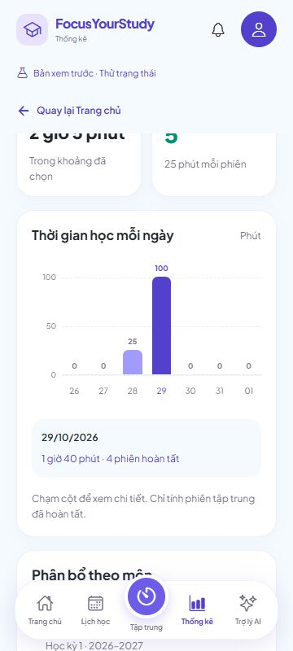
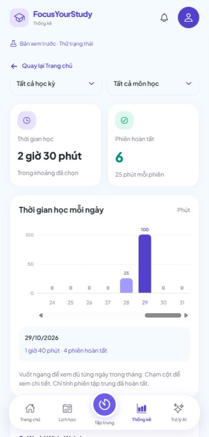

# 6C.2 — Thống kê thời gian học từ dữ liệu thật

Ngày 29/10/2026. Màn **Thống kê → Tổng quan** của tài khoản đọc `GET /api/v1/pomodoro-statistics` đã có ở 6C.1. Đợt này chỉ đổi frontend; không sửa backend, migration hoặc dependency.

## Đã làm

- Chọn **Tuần/Tháng**, nút trước/sau, về tuần/tháng hiện tại và chọn ngày bằng lịch. Tuần là thứ Hai–Chủ nhật, tháng là trọn tháng; theo múi giờ hồ sơ.
- Mặc định **Tất cả học kỳ/Tất cả môn học**, nên tài khoản chưa có danh mục hoặc nguồn đã xóa vẫn xem được lịch sử. Có lọc riêng học kỳ/môn; đổi học kỳ đặt bộ lọc môn về tất cả.
- Hai thẻ **Thời gian học/Phiên hoàn tất** lấy cùng response với biểu đồ và phân bố môn. Chỉ phiên COMPLETED được cộng; không cộng phiên hủy/đang học/tạm dừng.
- Biểu đồ giữ từng ngày riêng, kể cả ngày 0 phút. Tháng có 28–31 cột, cuộn ngang; tự đưa ngày đang xem vào vùng biểu đồ. Chạm một cột để đọc ngày, số phiên và thời gian của ngày đó.
- Phân bố theo môn dùng tên, mã và học kỳ lưu trên phiên; một môn ở hai kỳ không bị gộp nhầm. Có nhãn giữ lịch sử khi danh mục đã tải và môn không còn tồn tại.
- Tải/lỗi/thử lại/trống riêng biệt. Lỗi mạng không biến thành 0 phút; không dùng phiên mẫu hoặc toàn bộ lịch sử tải về để tự đoán số liệu tài khoản.
- Đọc lại khi phiên hoàn tất, trở lại màn/foreground/online, thông báo từ tab khác và mỗi 30 giây khi màn đang hiện. Giữ cơ chế hủy request, mã truy vấn và owner để phản hồi cũ không cập nhật nhầm tài khoản/bộ lọc.
- Chế độ xem thử giữ thống kê mẫu hiện có; hai tab **So sánh GPA/Điểm & GPA** giữ luồng riêng. Thẻ chuỗi ngày và tiến độ bài tập từ bộ nhớ không được dùng làm số liệu thật trong Tổng quan tài khoản. Chuỗi ngày thật ở 6C.3; tổng hợp bài tập tiếp tục theo checklist Dashboard/Thống kê.

## Bạn kiểm tra một vòng

### Chuẩn bị

1. Giữ backend đang chạy bằng `backend/scripts/Run-Local.ps1` hoặc IntelliJ. Nếu chưa chạy lại sau 6C.1 thì khởi động lại backend để có endpoint thống kê.
2. Chạy frontend như đang dùng:

```powershell
cd 'D:\Video OBS\QuanLyHocTap'
npx expo start --web --port 8092
```

Đăng nhập tài khoản đã có; vào **Thống kê → Tổng quan**. Bản export QA trong quá trình phát triển dùng cổng/schema riêng và không phải địa chỉ để chạy project hằng ngày.

### 1. Chưa có phiên hoàn tất

Tài khoản mới hoặc khoảng ngày chưa học phải hiện **0 phút, 0 phiên**, thông báo chưa có phiên và nút **Đến Pomodoro**. Không bắt buộc có học kỳ mới được đọc thống kê trống. Nếu là lỗi mạng thì phải hiện lỗi và **Thử lại thống kê**, không hiển thị 0 thay lỗi.

### 2. Chọn tuần/tháng

- Tuần mặc định chứa hôm nay, từ thứ Hai đến Chủ nhật.
- Chọn Tháng: đủ từng ngày trong tháng. Vuốt ngang để xem đầu/cuối tháng; chạm ngày đã học và ngày 0 phút để xem chi tiết.
- Dùng mũi tên trước/sau, rồi nút **Về tuần này/Về tháng này** để quay về hiện tại.
- Chọn **Chọn tuần/Chọn tháng → Ngày muốn xem thống kê**, chọn bằng lịch, xác nhận ngày và bấm **Xem thống kê ngày đã chọn**. Khoảng hiển thị phải chứa ngày đó.

Tuần/tháng có phạm vi khác nhau nên tổng không bắt buộc bằng nhau. Ngày có phiên qua nửa đêm lấy ngày kết thúc trong múi giờ hồ sơ.

### 3. Lọc học kỳ và môn

Chọn học kỳ, sau đó chọn môn. Tổng thời gian, số phiên, biểu đồ và tỷ lệ phân bố phải cùng thu hẹp theo bộ lọc. Chọn tất cả để bỏ lọc. Đổi sang học kỳ khác phải đưa môn về **Tất cả môn học**, tránh giữ môn của kỳ cũ.

Các môn đã xóa có phiên trong kết quả vẫn được nhận diện từ lịch sử. Phân bố dùng thông tin lúc học; tên môn hiện tại trong bộ chọn có thể khác tên đã lưu trên phiên.

### 4. Hoàn tất một phiên

Ghi lại số phiên/phút của tuần hiện tại với bộ lọc tất cả. Sang **Tập trung**, học đủ 25 phút và chờ backend xác nhận hoàn tất. Quay lại Thống kê: tăng **đúng 1 phiên và 25 phút**, vào đúng ngày/môn. Phiên hủy không làm tăng số liệu.

F5, vào lại Thống kê: số liệu vẫn còn, không cộng thêm lần nữa. Sau tải lại, bộ lọc trở về tuần hiện tại/tất cả; chọn lại cùng khoảng/bộ lọc trước khi so sánh.

### 5. Thử lỗi và đổi tài khoản

- Tạm dừng backend của bạn bằng Ctrl+C, bấm nút mũi tên vòng **Cập nhật thống kê**: hiện lỗi; thẻ/biểu đồ cũ được ẩn để tránh hiểu nhầm là dữ liệu mới.
- Chạy lại backend rồi bấm **Thử lại thống kê**, hoặc chờ lần đọc lại khi màn đang hiện: trả về đúng số liệu đã lưu.
- Đăng nhập tài khoản B chưa học: không thấy tổng/môn của A. Đổi lại A: đọc đúng lịch sử A.

## Kết quả đã kiểm tra

**TypeScript, 529 tests frontend (24 mới) và export web đạt; 0 lỗi/thất bại/bỏ qua.** Client mới đã đọc và xác minh dữ liệu với Spring Boot/PostgreSQL trong schema QA biệt lập, sau đó kiểm tra thao tác thực trên trình duyệt:

| Trường hợp | Kết quả quan sát |
| --- | --- |
| Tuần/tháng trước khi thêm phiên | Tuần 4 phiên/100 phút; tháng 5 phiên/125 phút. Biểu đồ có đủ 7/31 ngày. |
| Lọc | Tháng/học kỳ hiện tại còn 4 phiên/100 phút; chọn React còn 1 phiên/25 phút. |
| Khoảng trống | Tháng trước của React hiện 0 phút/0 phiên và thông báo trống. |
| Lịch chọn ngày | Chọn hôm nay bằng lịch, xác nhận và áp dụng: quay về đúng tháng hiện tại với bộ lọc đang chọn. |
| F5 | Giữ đăng nhập, vào lại Tổng quan vẫn có 4 phiên/100 phút trước khi thêm phiên. |
| Hoàn tất tự động | Đang ở Thống kê 4 phiên/100 phút; ứng dụng xác nhận phiên QA đủ giờ rồi tự cập nhật thành 5 phiên/125 phút, không bấm Cập nhật. |
| Backend tạm ngắt | Hiện lỗi kết nối và nút Thử lại; không biến thành 0 phút. Chạy lại cùng backend/schema, màn tự phục hồi 5 phiên/125 phút. |
| A → B → A | B chưa có học kỳ/phiên vẫn đọc được 0 phút/0 phiên, không thấy môn A; trở lại A đúng 5 phiên. |
| Tháng sau thêm phiên | 6 phiên/150 phút; ngày 29/10 có 4 phiên/100 phút, ngày 28/10 có 1 phiên/25 phút, phiên còn lại ở tuần trước. |
| Điện thoại trên web | 320/360/430px không tràn ngang trang; tháng vẫn đủ 31 cột trong vùng cuộn. Chạm được ngày 1 và 31. Radio bộ lọc đã chọn có aria-checked=true. |

Để không chờ 25 phút cho mỗi lần thử, timestamp chỉ được điều chỉnh trong **schema QA**; ứng dụng vẫn dùng API hoàn tất bình thường. Không thay giờ hệ thống, không thêm nút ép hoàn tất vào sản phẩm, không seed hoặc sửa dữ liệu tài khoản đang dùng. Sau kiểm tra, dịch vụ/schema QA được dọn.

Các unit tests mới kiểm tra ranh giới tuần/tháng, năm nhuận, ngày DST 23/25 giờ và ngày lịch bị bỏ qua, định dạng/bộ lọc/phản hồi sai, tổng ngày/môn khớp, snapshot khác kỳ, HTTP/Bearer/cancel, phản hồi chậm, lỗi/thử lại và đổi tài khoản. Kiểm tra API thật sau nghiệm thu: tuần 5 phiên/125 phút, tháng 6 phiên, kỳ hiện tại 4 phiên, Java 3 phiên và tài khoản B 0 phiên.

## Ảnh nghiệm thu





## Mã nguồn và phạm vi tiếp theo

- `src/features/statistics/api/`: kiểu dữ liệu, kiểm tra phản hồi API và hook đọc thống kê.
- `src/features/statistics/components/ServerStudyStats.tsx`: Tổng quan tài khoản.
- `ServerStatisticsFilters.tsx`: bộ lọc kỳ/môn và chọn ngày.
- `serverStatisticsView.ts`: dữ liệu biểu đồ/phân bố từ response, không tính lại thống kê từ bộ nhớ.
- `tests/pomodoro-statistics.test.cjs`: 24 kiểm thử mới.

**6C.3** tiếp tục chuỗi ngày học và Dashboard dùng dữ liệu thật, nghiệm thu liên thông. Điện thoại thật/chạy nền vẫn ở **2C.3B** đã hoãn. Không đánh dấu toàn bộ 6C hoàn tất trong đợt này.

Tên commit: **Kết nối thống kê thời gian học với dữ liệu backend**. Lệnh push tại [GIT-COMMITS.md](GIT-COMMITS.md).
