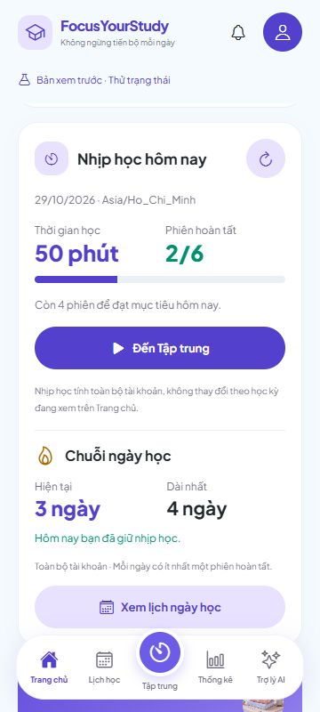
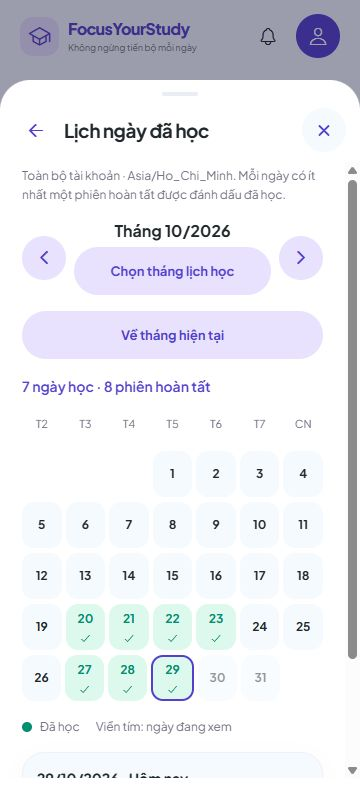

# 6C.3B — Chuỗi ngày học và Dashboard dùng dữ liệu Pomodoro

Ngày 29/10/2026. Đã nối giao diện web với API chuỗi ngày ở 6C.3A và tiến độ ngày ở 6A.2. Không thay backend, schema hoặc dependency.

## Đã làm

- **Trang chủ → Nhịp học hôm nay:** phút học, số phiên/mục tiêu, tiến độ và nút đến Tập trung; chuỗi hiện tại/dài nhất, lời nhắc giữ chuỗi và nút mở lịch. Tài khoản chưa có học kỳ vẫn đọc được tiến độ trống hoặc lịch sử còn giữ.
- **Tập trung:** mục tiêu ngày và lịch sử giữ luồng hiện có; bổ sung chuỗi/lịch ngày học. Lưu mục tiêu xong làm mới tiến độ dùng chung trên các màn.
- **Thống kê → Tổng quan:** giữ biểu đồ/bộ lọc 6C.2, bổ sung chuỗi/lịch. Chuỗi luôn toàn tài khoản, không lọc theo môn/học kỳ đang xem. Tổng tuần/tháng vẫn áp dụng bộ lọc riêng.
- **Lịch ngày đã học:** lùi/tiến/chọn tháng bằng lịch, về tháng hiện tại, đủ ô ngày theo thứ Hai–Chủ nhật; ngày đã học có dấu kiểm, chọn ngày để xem số phiên/phút, ngày tương lai và tháng trống có thông báo rõ.
- Đọc dữ liệu sau hoàn tất, F5, trở lại foreground/online và đồng bộ tab; tự đọc lại khi app đang hiện. Tải/lỗi/trống/thử lại không trộn nhau; đổi tài khoản dọn trạng thái cũ.
- Giữ chế độ xem thử riêng. Số ngày/phiên tài khoản không lấy từ bộ nhớ mẫu.

## Các lỗi phát hiện và đã sửa khi thử UI

1. Lịch mở từ Dashboard bị mất khi tiến độ tự tải lại: giữ component lịch ở cùng vị trí và giữ ngày/tháng đã xác nhận từ server; đã để lịch mở ở tháng 9 qua một chu kỳ refresh và kiểm tra vẫn đúng tháng đang chọn.
2. Nút X/nền ngoài của lịch có thể gọi luồng đóng của Trang chủ thay vì đóng lịch: lịch có FlowScope riêng; đã kiểm tra đóng bằng X và Escape.
3. Trong lúc làm mới, không chuyển tháng lịch về ngày UTC của thiết bị hoặc làm bộ lọc Thống kê nhảy qua lại. Giữ ngày đã xác nhận gần nhất cho đến phản hồi server mới.

## Bạn kiểm tra một vòng

### Chuẩn bị

Giữ backend và frontend chạy. Nếu chưa khởi động lại backend sau 6C.3A thì dừng bằng Ctrl+C và chạy lại:

```powershell
cd 'D:\Video OBS\QuanLyHocTap\backend'
.\scripts\Run-Local.ps1
```

Frontend ở terminal khác:

```powershell
cd 'D:\Video OBS\QuanLyHocTap'
npx expo start --web --port 8092
```

Đăng nhập tài khoản của bạn, tải lại app rồi vào Trang chủ. Địa chỉ/cổng/schema QA trong quá trình phát triển không dùng để chạy app hằng ngày.

### 1. Tài khoản mới hoặc hôm nay chưa học

Thẻ **Nhịp học hôm nay** hiện 0 phút, 0/mục tiêu. Chuỗi bằng 0 nếu chưa học bao giờ; nếu đã học liên tiếp đến hôm qua thì vẫn giữ số ngày đó và nhắc hoàn tất một phiên hôm nay. Không bắt buộc đạt toàn bộ mục tiêu ngày mới được tính một ngày học.

Mục tiêu mặc định là 4 nếu chưa thay đổi. Nếu chưa có học kỳ/môn thì vẫn xem được thẻ và lịch trống, sau đó tạo học kỳ/môn để bắt đầu phiên.

### 2. Đổi mục tiêu

Vào **Tập trung → Sửa mục tiêu**, chọn số phiên và lưu. Quay về Trang chủ: mẫu số của tiến độ phải giống Tập trung; số phiên đã hoàn tất, phút và chuỗi không đổi.

### 3. Hoàn tất một phiên

1. Ghi lại phút/số phiên hôm nay và chuỗi hiện tại.
2. Sang Tập trung, bắt đầu và học đủ 25 phút. Chờ xác nhận đã hoàn tất từ backend.
3. Trang chủ và Tập trung tăng đúng 1 phiên/25 phút. Nếu là phiên đầu tiên của hôm nay thì ngày hôm nay được đánh dấu; chuỗi tăng hoặc bắt đầu lại theo lịch trước đó.
4. Mở lịch từ Trang chủ/Tập trung/Thống kê, chọn ngày hôm nay: số phiên/phút phải khớp hai thẻ hôm nay.
5. Mở Thống kê, chọn khoảng có hôm nay và bỏ lọc kỳ/môn nếu muốn so toàn tài khoản: tổng tăng cùng 1 phiên/25 phút. Tổng cả tuần/tháng có thể lớn hơn số hôm nay vì còn các ngày khác.

Phiên thứ hai cùng ngày tăng tiếp số phiên/phút, nhưng không tăng thêm ngày trong chuỗi. Phiên hủy không được cộng. F5 không cộng lại hoặc đặt lại số liệu đã lưu.

### 4. Dùng lịch ngày học

- Bấm **Xem lịch ngày học**, chọn ô có dấu kiểm và ô trống để xem chi tiết. Tím là ngày đang xem; nhãn ngày hôm nay xuất hiện trong phần chi tiết.
- Dùng mũi tên qua tháng trước/sau; dùng **Chọn tháng lịch học → Ngày trong tháng lịch học → Áp dụng tháng lịch học** để chọn tháng xa hơn. Nút **Về tháng hiện tại** trở lại tháng theo ngày server.
- Tháng tương lai/trống có 0 ngày học; chuỗi hiện tại/dài nhất trên thẻ vẫn giữ nguyên.
- Để lịch mở qua một lần tự cập nhật: lịch không tự đóng, tháng đang chọn không bị đổi. X/Escape/Quay lại đóng đúng lịch.

### 5. Lỗi mạng và tài khoản riêng

Tạm dừng backend của bạn, bấm nút làm mới trên thẻ **Nhịp học hôm nay**: phải hiện lỗi và nút **Thử lại nhịp học**, không hiện 0 thay lỗi. Chạy lại backend rồi thử lại hoặc chờ lần đọc mới; số liệu đã lưu phải trở lại.

Đăng nhập B chưa học: không thấy ngày học, phút hoặc chuỗi của A. Đổi lại A: đọc đúng dữ liệu A. Khi thử bộ lọc môn/học kỳ ở Thống kê, thẻ chuỗi vẫn ghi rõ **Toàn bộ tài khoản**.

Khi qua ngày mới, tiến độ hôm nay đọc theo ngày server, chuỗi có thể giữ đến hôm qua. App đọc lại khi trở về foreground và định kỳ 30 giây khi đang hiện; không cam kết đổi số trong đúng từng mili giây lúc nửa đêm.

## Kết quả nghiệm thu

**TypeScript, 557 tests frontend (28 mới) và export web đạt; không lỗi/thất bại/bỏ qua.** Đã dùng backend Spring Boot/PostgreSQL với schema QA riêng để thao tác trực tiếp trên web:

| Trường hợp | Kết quả đã quan sát |
| --- | --- |
| Trước khi học hôm nay | A có 0/4, 0 phút, chuỗi 2 ngày đến hôm qua, kỷ lục 4 ngày. Một phiên hủy trong fixture không được cộng. |
| Đổi mục tiêu | Chọn 6 trên Tập trung, Trang chủ và Tập trung đều 0/6, chuỗi vẫn 2 ngày. |
| Phiên đầu | Bắt đầu bằng UI, app xác nhận hoàn tất: 1/6, 25 phút, chuỗi 3 ngày, dài nhất 4 ngày. |
| Ba màn/F5 | Trang chủ/Tập trung có 1 phiên hôm nay; lịch từ Thống kê cho ngày 29/10 là 1 phiên/25 phút; tuần có 3 phiên/75 phút do thêm hai ngày trước. F5 giữ 1/6. |
| Phiên thứ hai + replay | 2/6, 50 phút, chuỗi vẫn 3 và dài nhất 4; lịch hôm nay 2 phiên/50 phút. Gửi lại Complete không cộng trùng. |
| Tháng/lịch | Tháng 9 trống, tháng 11 tương lai trống; tháng 10 có 7 ngày học và 8 phiên. Chọn ngày 28 xem 1 phiên/25 phút; chọn ngày 29 xem 2 phiên/50 phút. Chọn tháng qua bộ chọn ngày được áp dụng. |
| Giữ lịch/đóng | Giữ lịch tháng 9 qua refresh; X và Escape đóng đúng lịch. |
| Mất kết nối | Hiện lỗi và Thử lại, không còn thẻ số cũ/không biến thành 0. Backend chạy lại tự phục hồi 2/6, 50 phút. |
| A → B → A | B không có học kỳ vẫn hiện 0/4, 0 phút, chuỗi/kỷ lục 0 và lịch trống; Tập trung/Thống kê cũng 0. Trở lại A đúng 2/6, 50 phút, chuỗi 3 ngày. |
| Màn hình nhỏ | 320/360/430px không tràn ngang trang; lịch tháng đủ 31 ô ngày, nút/ngày có nhãn và trạng thái chọn cho trợ năng. |

Để kiểm tra hoàn tất mà không chờ 25 phút mỗi lần, timestamp chỉ được điều chỉnh trong schema QA, ứng dụng vẫn xác nhận qua API bình thường. Không sửa giờ hệ thống, không thêm nút ép hoàn tất vào sản phẩm, không seed/reset dữ liệu người dùng. Sau nghiệm thu, dịch vụ/schema QA được dọn.

Các ca qua nửa đêm, DST 23/25 giờ, ngày lịch bị bỏ qua, ngày thiết bị lệch, lỗi/abort, phản hồi cũ và hai lần đọc thay đổi được kiểm tra tự động. Không mô phỏng thay đồng hồ hệ thống để tuyên bố đã trực tiếp chờ qua nửa đêm trên UI.

## Cách nối dữ liệu

`PomodoroProgressProvider` nằm trong provider phiên tập trung và giữ một trạng thái tiến độ theo owner. Trang chủ/Tập trung/Thống kê dùng cùng trạng thái này. `pomodoroProgressApi` đọc chuỗi trước để lấy today từ server, rồi đọc Daily cho đúng ngày đó. Nếu số phiên/ms hoặc khoảng ngày của hai phản hồi chưa khớp vì vừa có Complete, chỉ đọc lại tối đa một lượt; nếu vẫn khác thì báo cần cập nhật, không ghép số hoặc tự tăng bộ đếm. Các lần đọc riêng có thể thấy dữ liệu mới hơn; mọi thay đổi vẫn do backend xác nhận.

`pomodoroStreakApi` kiểm tra cấu trúc, khoảng tháng/ngày/múi giờ và tổng calendar, không tự tính lại chuỗi dài nhất từ một tháng. Lịch mở theo tháng dùng request riêng có guard owner/query/abort; giữ lựa chọn qua lần làm mới. Mẫu số mục tiêu lấy từ goal đã lưu, không từ bản nháp chưa xác nhận.

Frontend mới nằm trong `src/features/focus/api/`, các component chuỗi/lịch ở `src/features/focus/components/`, thẻ Trang chủ ở `src/features/dashboard/components/ServerDashboardPomodoro.tsx`. `tests/pomodoro-streak.test.cjs` có 28 test mới. Các API/backend V11 giữ nguyên.

## Ảnh dữ liệu QA





Hoàn tất phạm vi **6C trên web**. Điện thoại thật, khóa màn hình và chạy nền vẫn ở **2C.3B** đã hoãn; chưa đánh dấu toàn bộ giai đoạn Pomodoro trên mọi nền tảng hoàn tất. Dashboard/thống kê ngoài dữ liệu Pomodoro tiếp tục theo các mục còn mở trong checklist.

Tên commit: **Kết nối chuỗi ngày học và Dashboard với dữ liệu Pomodoro**. Lệnh push tại [GIT-COMMITS.md](GIT-COMMITS.md).
