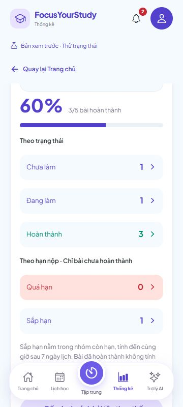

# 7A.2 — Tiến độ bài tập trên Thống kê

Ngày 29/10/2026. Đã nối API 7A.1 vào **Thống kê → Tổng quan → Tiến độ bài tập**. Không thay backend/schema/dependency; vẫn API và Flyway V11 hiện có.

## Đã bổ sung

- Chọn **Học kỳ tiến độ bài tập** và **Môn học tiến độ bài tập**. Mặc định học kỳ đang chọn trong không gian học tập nếu có, sau đó kỳ Đang học hoặc kỳ đầu danh sách. Đổi kỳ xóa lọc môn để không vô tình giữ môn của kỳ cũ.
- Tổng hoàn thành/tổng bài, phần trăm và thanh tiến độ từ API. Ví dụ 2/5 = 40%, 3/5 = 60%. Không tính lại phần trăm từ các bản nháp hoặc tự cộng khi bấm nút lưu.
- Năm nhóm bấm được: **Chưa làm**, **Đang làm**, **Hoàn thành**, **Quá hạn**, **Sắp hạn**. Nút **Đến danh sách bài tập theo thống kê** mở tất cả trong đúng kỳ/môn.
- Bộ chọn riêng với biểu đồ Pomodoro. Biểu đồ có thể xem tất cả học kỳ và lịch sử môn đã xóa; tiến độ bài tập cần học kỳ/môn hiện đang tồn tại, tính toàn bộ bài trong phạm vi đó. Tuần/tháng phía trên không thay mẫu số bài tập.
- Trạng thái đang tải, chưa có kỳ, chưa có bài, lỗi và thử lại. Phản hồi cũ của kỳ/môn/tài khoản không được ghi đè lựa chọn mới. Khi đọc lỗi, ẩn bộ đếm thay vì hiện 0/0.

## Bạn kiểm tra như sau

### 1. Mở app

Backend phải có 7A.1: nếu chưa khởi động lại sau đợt đó, Ctrl+C ở terminal backend rồi chạy lại:

```powershell
cd 'D:\Video OBS\QuanLyHocTap\backend'
.\scripts\Run-Local.ps1
```

Dùng frontend đang chạy; nếu chưa chạy thì mở terminal khác:

```powershell
cd 'D:\Video OBS\QuanLyHocTap'
npx expo start --web --port 8092
```

Đăng nhập, vào **Thống kê → Tổng quan**, cuộn tới **Tiến độ bài tập**. Bản xem thử giữ dữ liệu mẫu và luồng cũ; chọn tài khoản thật để kiểm tra API.

### 2. Chọn phạm vi và đối chiếu số liệu

1. Chọn học kỳ trong thẻ tiến độ, để tất cả môn. Đếm bài trong kỳ và trạng thái để đối chiếu.
2. Chọn riêng một môn: tổng và số hoàn thành chỉ tính môn đó. Đổi sang kỳ khác: môn trở về **Tất cả môn trong học kỳ**.
3. Đổi Tuần/Tháng hoặc khoảng trên biểu đồ Pomodoro: tiến độ bài tập vẫn theo kỳ/môn riêng của nó.
4. Bấm nút mũi tên làm mới ở tiêu đề **Tiến độ bài tập** để đọc lại API. Mốc **Tính tại** cho biết thời điểm server tính và múi giờ hồ sơ.

Bài COMPLETED không tính quá hạn kể cả deadline đã qua. Sắp hạn chỉ tính bài chưa xong, từ mốc hiện tại tới cùng giờ sau 7 ngày lịch. Hai nhóm trạng thái/hạn nộp có phần giao nhau, không cộng cả năm nhãn thành tổng.

### 3. Bấm nhóm để mở danh sách

| Bấm trong Thống kê | Bộ lọc ở danh sách |
| --- | --- |
| Chưa làm | Trạng thái Chưa làm; hạn nộp Tất cả |
| Đang làm | Trạng thái Đang làm; hạn nộp Tất cả |
| Hoàn thành | Trạng thái Hoàn thành; hạn nộp Tất cả |
| Quá hạn | Trạng thái Tất cả; hạn nộp Quá hạn, tự loại bài hoàn thành |
| Sắp hạn | Trạng thái Tất cả; hạn nộp Sắp hạn, tự loại bài hoàn thành |
| Đến danh sách bài tập theo thống kê | Tất cả trạng thái/hạn, giữ kỳ/môn |

Mỗi lần mở từ thẻ dùng một lượt điều hướng mới: không giữ từ khóa, trạng thái hoặc bộ lọc cũ từ lần vào danh sách trước. App đọc lại bài tập và danh mục kỳ/môn; danh sách liên kết không hiển thị hàng cũ trong lúc đối chiếu hoặc khi đọc lỗi.

Trên danh sách có thẻ **Từ Thống kê** ghi rõ mốc đối chiếu. Hạn nộp/nhãn ngày dùng zone và mốc của thống kê, không tự tính lại 7 ngày theo múi giờ máy. Deadline được so đến microsecond, đúng cả hai biên của sắp hạn; không biến bài ngay tại mốc thành quá hạn do làm tròn millisecond.

Thời điểm đối chiếu được giữ khi bạn ở danh sách, trong khi trạng thái bài dùng bản đã lưu mới nhất. Nếu có người sửa bài ở nơi khác sau khi mở thống kê, số hàng có thể thay đổi; quay về để lấy mốc/số liệu mới. Nút **Về Thống kê để cập nhật mốc** hoặc **Quay lại màn trước** trở lại đúng thẻ với kỳ/môn đã chọn, rồi đọc lại số liệu. Sửa bộ lọc kỳ trực tiếp ở danh sách hoặc xóa toàn bộ bộ lọc sẽ về luồng danh sách thông thường, dùng giờ thiết bị như trước.

### 4. Sửa trạng thái rồi quay lại

1. Ghi lại tổng/hoàn thành/quá hạn.
2. Bấm **Quá hạn**, mở một bài chưa xong, chuyển sang **Hoàn thành**, chờ thông báo đã lưu.
3. Đóng chi tiết: bài rời danh sách quá hạn. Bấm **Về Thống kê để cập nhật mốc**: completed tăng 1, quá hạn giảm 1, tổng giữ nguyên.
4. Bấm lần lượt các nhóm khác và kiểm tra số hàng. Thử nhập từ khóa không có kết quả, quay về rồi bấm nhóm khác: từ khóa cũ phải được xóa.
5. F5, mở lại Thống kê: số liệu đã lưu vẫn còn. Bộ chọn/điều hướng trong phiên không được cam kết lưu vĩnh viễn qua F5.

### 5. Trống và lỗi

- Tài khoản chưa có học kỳ: hướng dẫn **Tạo học kỳ và môn**; không gọi API với ID trống rồi diễn giải lỗi thành 0.
- Kỳ có thật nhưng chưa có bài: hiện **Chưa có bài tập trong phạm vi này** và lối mở danh sách, không hiện 100% hoặc số của kỳ/tài khoản trước.
- Tạm tắt backend của bạn, bấm cập nhật tiến độ: hiện **Chưa tải được tiến độ bài tập** cùng **Thử lại tiến độ bài tập**; ẩn phần trăm/bộ đếm.
- Chạy lại backend, bấm thử lại hoặc chờ lần đọc kế tiếp: số liệu trở lại. Nếu kỳ/môn đã bị xóa, tải lại danh mục và chọn lại phạm vi; không tự chuyển sang kỳ khác để che lỗi.
- Đổi tài khoản B rồi trở lại A: số liệu và lựa chọn cũ của A không hiện trong B.

## Nghiệm thu đã thực hiện

**TypeScript, export web và 581 tests frontend qua (24 mới), không lỗi/bỏ qua.** Backend không đổi; 723 tests/Maven verify là kết quả 7A.1, không chạy lại trong đợt chỉ sửa frontend này.

24 tests mới kiểm tra parser/query/public fields, phần trăm HALF_UP, số liệu trống/lỗi, UTC/offset/microsecond, DST 167/169 giờ, HTTP/abort, ánh xạ nhóm, kết hợp tìm kiếm/trạng thái/môn/kỳ, ngày theo zone server và chặn phản hồi cũ/khác tài khoản/dispose. Thời gian IANA và ranh giới do API trả được giữ nguyên khi mở danh sách.

Đã thử UI trên web với Spring Boot/PostgreSQL/schema QA riêng:

| Tình huống | Kết quả quan sát |
| --- | --- |
| Ban đầu | Kỳ 1: 5 bài, 2 hoàn thành, 40%; TODO 2, đang làm 1, quá hạn 1, sắp hạn 1. |
| Hoàn thành bài quá hạn qua UI | Danh sách quá hạn còn 0; quay lại Thống kê là 3/5, 60%, quá hạn 0. |
| Năm nhóm | Mở đúng 1/1/3/0/1 hàng cho chưa làm/đang làm/hoàn thành/quá hạn/sắp hạn sau bước trên. |
| Bộ lọc cũ | Tìm từ khóa không có kết quả ở một nhóm, quay lại mở nhóm khác vẫn đúng số hàng; không giữ từ khóa cũ. |
| Môn React | 1/2, 50%; mở tất cả có đúng 2 bài; Quay lại giữ lựa chọn React. |
| Kỳ 2 và biểu đồ | Kỳ 2 là 0/1; đổi kỳ bỏ lọc React, đổi biểu đồ sang Tháng vẫn 0/1. |
| F5 | Tài khoản giữ đăng nhập; mở lại Thống kê đọc 3/5 từ server. |
| Offline/restart | Hiện lỗi, bộ đếm cũ biến mất, có thử lại; restart cùng schema khôi phục 3/5. |
| A → B → A | B chưa có kỳ hiện hướng dẫn; sau khi tạo kỳ trống chỉ trong QA, B hiện chưa có bài. Trở lại A đúng 3/5. |
| Responsive | 320/360/430px không tràn ngang; ảnh 360px lưu kèm. |

Tab, dịch vụ và schema QA đã được dọn; không seed/reset tài khoản người dùng. Bản export bình thường đã kiểm tra không có địa chỉ backend QA. Không dùng viewport web để tuyên bố đã nghiệm thu điện thoại thật/chạy nền.



## Vị trí mã nguồn

- `src/features/statistics/api/assignmentStatisticsApi.ts`: đọc/kiểm tra phản hồi 7A.1; `useAssignmentStatistics.ts` dùng lại read manager có owner/query/revision/abort và refresh khi trở lại màn/foreground/online, đọc định kỳ 30 giây khi hiện.
- `src/features/statistics/components/ServerAssignmentProgressCard.tsx`, `AssignmentProgressFilters.tsx`: thẻ tiến độ và bộ chọn danh mục hiện tại.
- `src/features/assignments/assignmentStatisticsLink.ts`: ánh xạ nhóm và bộ lọc/mốc dùng cho danh sách; `src/shared/utils/instantMicros.ts` giữ chính xác microsecond.
- `src/store/model.tsx`, `App.tsx`: điểm mở danh sách mới, remount bộ lọc và vùng nhớ cuộn cho mỗi lượt mở từ Thống kê. Back stack hiện có giữ màn Thống kê và lựa chọn.
- `AssignmentsScreen.tsx`, `components/AssignmentCard.tsx`: hiển thị danh sách/nhãn ngày theo mốc khi đến từ thống kê; luồng vào thông thường và bản mẫu giữ cách hoạt động cũ.

**7A.3 còn mở:** nghiệm thu ma trận đầy đủ sửa deadline, xóa, chuyển môn, hai tab/phiên bản và đối chiếu Dashboard–Thống kê–danh sách. Các ca sửa trạng thái cơ bản ở đây không thay cho toàn bộ nghiệm thu đó. Native 2C.3B/GPA đặc thù đã hoãn giữ nguyên.

Tên commit: **Kết nối thống kê tiến độ bài tập với giao diện**. Lệnh push ở [GIT-COMMITS.md](GIT-COMMITS.md).
