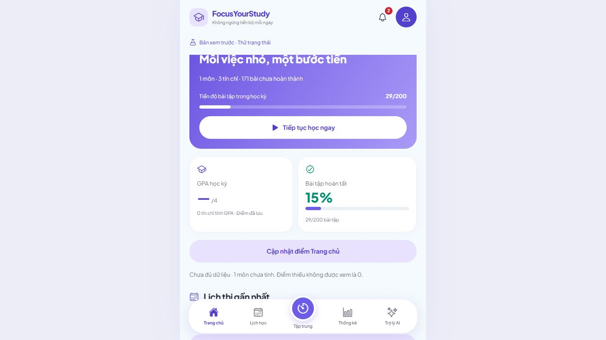
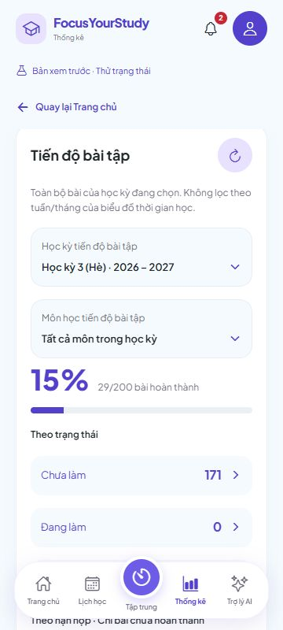

# 7A.3 — Nghiệm thu liên thông tiến độ bài tập

Ngày 30/10/2026. Hoàn tất phạm vi **7A trên web**: API 7A.1, giao diện 7A.2 và nghiệm thu Dashboard–Bài tập–Thống kê. Không thay backend, migration, dependency hoặc dữ liệu người dùng; vẫn V11.

## Lỗi phát hiện và đã sửa

### 1. Phần trăm tại điểm làm tròn

Dashboard/bản xem thử trước đây dùng `Math.round(done / total * 100)`. Với 29/200, phép toán số thực tạo giá trị nhỏ hơn 14.5 một chút và trả **14%**, trong khi API HALF_UP trả **15%**.

Đã dùng chung `completionPercent` với phép toán số nguyên cho Dashboard, bản xem thử và parser API. 29/200 = 15%, 1/8 = 13%, 2/3 = 67%; kỳ trống giữ 0/0 và trạng thái chưa có bài. Không đổi trạng thái hay số lượng bài để làm hai màn trông giống nhau.

### 2. Tab khác còn giữ danh sách cũ

Nguồn bài tập/kỳ/môn trước đây chỉ đọc lúc mở app hoặc khi người dùng bấm tải lại/lưu. Thẻ Thống kê có thể đã đọc API mới nhưng Dashboard của tab khác còn dùng danh sách cũ.

Đã bổ sung tín hiệu thay đổi theo **API endpoint + tài khoản** sau thao tác kỳ/môn/bài tập. Tab cùng địa chỉ app đọc lại các danh mục khi hiện, trở lại foreground/online và định kỳ 30 giây. Tín hiệu chỉ chứa giá trị ngẫu nhiên/thời gian; không chuyển token, mật khẩu, ghi chú hoặc nội dung bài tập qua localStorage. Khi storage bị chặn, vẫn có đọc foreground/polling.

Các lượt đọc được gộp, chờ thao tác đang bận kết thúc. Bản nháp trong form và phiên bản đã mở form được giữ; dữ liệu mới không tự biến thành phiên bản của bản nháp cũ. **Không tự gửi lại thao tác ghi, không tự xóa `needsReload` khi có yêu cầu cần đối chiếu.** Nếu nguồn đã báo cần tải lại sau lỗi/xung đột, người dùng dùng nút tải/nạp bản mới hiện có. Không coi việc GET thành công ở màn khác là bằng chứng có thể gửi lại bản nháp cũ.

## Cách bạn kiểm tra

### Chuẩn bị

Giữ backend 7A.1 chạy, tải lại frontend để nhận sửa 7A.3. Nếu chưa chạy:

```powershell
# Terminal backend
cd 'D:\Video OBS\QuanLyHocTap\backend'
.\scripts\Run-Local.ps1
```

```powershell
# Terminal frontend khác
cd 'D:\Video OBS\QuanLyHocTap'
npx expo start --web --port 8092
```

Dùng URL/cổng frontend bạn đang chạy nếu đã mở app. Có thể dùng tài khoản thử và bài đặt tên `TEST 7A3`. Chọn cùng học kỳ, để **tất cả môn** trên Thống kê khi so với Dashboard vì Dashboard tổng hợp cả kỳ.

### A. Deadline và trạng thái

1. Ghi lại tổng/hoàn thành/quá hạn/sắp hạn ở Thống kê; bấm nhóm để mở danh sách.
2. Với một bài chưa xong, dời hạn từ đã qua sang ngày mai: quá hạn giảm 1, sắp hạn tăng 1; tổng/hoàn thành giữ nguyên.
3. Dời tiếp ra sau hơn 7 ngày: sắp hạn giảm 1. Bài vẫn nằm trong Chưa làm/Đang làm theo trạng thái.
4. Đánh dấu Hoàn thành: số hoàn thành tăng 1, phần trăm cập nhật. Bài không còn trong quá hạn/sắp hạn dù deadline cũ.
5. Quay về Thống kê hoặc Trang chủ và so số liệu; F5 rồi mở lại đúng kỳ để kiểm tra dữ liệu vẫn còn. Mốc API và thời gian thực của Dashboard có thể khác nhau nếu bạn chọn bài sát đúng giây đến hạn; dùng mốc ghi ở Thống kê để đối chiếu danh sách mở từ đó.

### B. Chuyển môn/học kỳ và xóa

- Chuyển một bài sang môn khác cùng kỳ: tổng cả kỳ không đổi, bộ lọc từng môn phải đổi đúng.
- Chuyển bài sang môn thuộc kỳ khác: kỳ cũ giảm tổng 1, kỳ mới tăng tổng 1. Nếu bài hoàn thành thì completed cũng chuyển tương ứng. Tên/mã môn giống nhau ở hai kỳ không được trộn.
- Bài có buổi tự học liên kết phải báo cần gỡ liên kết khi đổi môn; dời hạn trước lúc kết thúc buổi học cũng bị chặn. Khi bị chặn, số liệu/version phải giữ nguyên.
- Xóa một bài thử sau khi xác nhận trong app: tổng và nhóm của bài đó giảm. Bài đã hoàn thành bị xóa cũng làm số hoàn thành giảm, phần trăm phải tính lại theo tổng mới. Những buổi tự học đã lưu được giữ và gỡ liên kết theo luồng backend hiện có.

### C. Hai tab thật

1. Copy **đúng URL frontend đang dùng** sang tab mới (cùng host/cổng). Tab mới khôi phục phiên đăng nhập. Đây là hai tab trình duyệt, không phải hai terminal.
2. Tab A mở bài tập, tab B giữ Dashboard hoặc Thống kê cùng kỳ. Đổi trạng thái/deadline ở A và chờ lưu thành công: B cập nhật khi nhận tín hiệu, trở lại foreground hoặc lần đọc định kỳ. Không cần F5 để lấy danh sách mới.
3. Mở form sửa **cùng một bài** ở hai tab. Gõ một bản nháp ở B, chưa lưu. Lưu một thay đổi khác ở A.
4. Trở lại B: bản nháp vẫn còn. Bấm Lưu ở B phải bị chặn do version cũ; dữ liệu A không bị ghi đè.
5. Bấm **Nạp bản bài tập mới nhất** khi đã đọc thông báo việc này sẽ thay nội dung đang sửa. Kiểm tra thấy bản A rồi chỉnh/lưu lại nếu muốn. App không tự nạp bản mới vào ô đang gõ.

Nếu nguồn báo cần tải lại sau lỗi mạng/thao tác chưa rõ kết quả, dùng nút tải lại danh sách hoặc nạp bản mới để đối chiếu; cơ chế đồng bộ không tự bỏ yêu cầu kiểm tra đó. Thay đổi từ công cụ/thiết bị khác không phát tín hiệu localStorage vẫn được đọc ở foreground/lần polling tiếp theo khi nguồn không bị khóa đối chiếu.

### D. Trống, lỗi và tài khoản khác

Kỳ trống phải có trạng thái chưa có bài; không thành 100%. Lỗi API không được coi là dữ liệu 0. Nếu học kỳ/môn đã bị xóa, tải danh mục và chọn lại đúng phạm vi. Đổi tài khoản không được giữ số liệu/bộ lọc của tài khoản trước; tín hiệu đồng bộ và manager cũ được hủy theo owner.

## Kết quả đã chạy

**TypeScript, 594 tests frontend (13 mới) và export web đạt, không lỗi/bỏ qua.** Backend không đổi; 723 tests/Maven verify là kết quả 7A.1, không chạy lại bộ Maven trong đợt frontend này.

13 tests mới: HALF_UP và số liệu sai, Dashboard 29/200, scope owner/API của tín hiệu, gộp sự kiện, chờ busy/loading, giữ khóa đối chiếu, nền/foreground, dispose owner cũ, lỗi đọc không lặp vô hạn, sự kiện đến giữa lượt đọc và giữ basis/bản nháp khi nguồn cập nhật.

Đã chạy **16 mốc đối chiếu frontend Manager/API/PostgreSQL thật** trong schema QA riêng: đọc các bộ lọc danh sách, `dashboardData` và API thống kê cùng phạm vi; đổi deadline/trạng thái, chuyển/xóa, version conflict + rebase thủ công, phản hồi PUT bị làm thất lạc sau commit, guard buổi tự học, owner A/B và 29/200. Không tạo API ép hoàn tất hoặc thay giờ hệ thống. Kết quả số liệu không chứa thông tin tài khoản tại [assignment-progress-7a3.json](test-results/assignment-progress-7a3.json).

Thao tác UI bằng hai tab của cùng app:

| Tình huống | Kết quả quan sát |
| --- | --- |
| Hoàn thành ở tab A, B giữ Dashboard | A Thống kê 3/5; B Dashboard tự đổi 2/5 → 3/5. |
| B đang gõ, A lưu trước | B giữ “Bản nháp tab B cần giữ”; lưu bị chặn, nút Lưu khóa và có Nạp bản mới. Nạp thủ công thấy “Đã lưu từ tab A”. |
| Dời deadline xa → ngày mai qua bộ chọn lịch | B tự hiện 2 bài sắp hạn. |
| Chuyển bài sang môn cùng tên ở kỳ 2 | Kỳ 1: Dashboard/Thống kê đều 3/4, 75%. Kỳ 2: 0/2, danh sách có đúng bài vừa chuyển. |
| Xóa bài vừa chuyển qua API riêng của QA | B tự đổi kỳ 2 còn 0/1; danh sách chỉ còn 1, không có bài đã xóa; Dashboard kỳ 2 cũng 0/1. |
| Làm tròn tại 29/200 | Dashboard và Thống kê cùng 29/200, 15%. |
| F5 | Dashboard đọc lại kỳ 1 là 3/4 từ PostgreSQL; không phải số đếm trong RAM. |
| Responsive | Tab B kiểm tra 320/360/430px không tràn ngang; Dashboard còn kiểm tra ở viewport desktop mặc định. |

Các ca xóa/mất phản hồi/guard có phần được thử bằng API và frontend Manager, không gọi tất cả là thao tác UI. Trạng thái trống/offline/restart/A → B → A đã nghiệm thu UI tại 7A.2, thêm kiểm tra guard owner/dispose ở 7A.3. Không suy kiểm tra viewport thành nghiệm thu điện thoại thật. Native/chạy nền 2C.3B và GPA đặc thù vẫn hoãn.

Ảnh Dashboard (desktop) và Thống kê (360px) cho cùng ca làm tròn:





Tab, dịch vụ và schema QA đã được dọn; PostgreSQL/dữ liệu người dùng giữ nguyên. Bản export bình thường đã kiểm tra không chứa địa chỉ backend QA.

## Mã nguồn thay đổi

- `src/shared/utils/completionPercent.ts`: HALF_UP dùng số nguyên; Dashboard, bản mẫu và parser API dùng chung.
- `src/shared/sync/SourceSync.ts`: gộp/defer GET, foreground và cleanup, giữ yêu cầu đối chiếu.
- `src/shared/sync/academicSyncPlatform.web.ts` / `.ts`: tín hiệu web theo endpoint/owner, lifecycle/polling; native chỉ có lifecycle adapter, chưa nghiệm thu máy thật.
- Các hook `useServerAssignments`, `useServerCourses`, `useServerSemesters`: đăng ký/dọn đồng bộ, phát tín hiệu khi kết thúc thao tác ghi; không thay API ghi/version.
- `tests/academic-sync.test.cjs`: 13 tests mới.

**7A đã hoàn tất trên web.** Giai đoạn 7 tổng thể còn các mục Dashboard/thông báo khác trong checklist; không đánh dấu toàn bộ dự án hoàn thành.

Tên commit: **Hoàn thiện liên thông thống kê tiến độ bài tập**.

```powershell
cd 'D:\Video OBS\QuanLyHocTap'
git add .
git commit -m "Hoàn thiện liên thông thống kê tiến độ bài tập"
git push origin main
```
