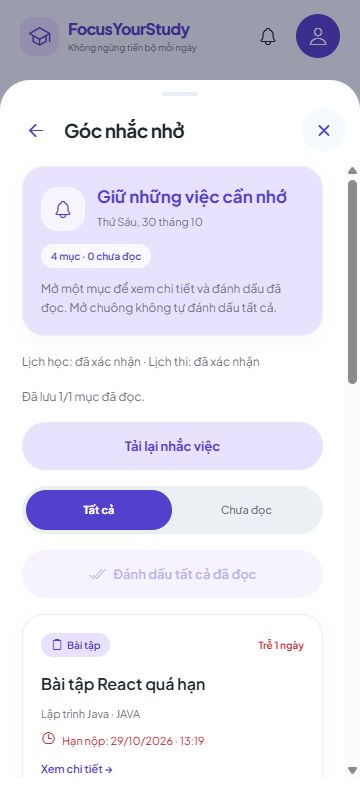

# 7B.2 — Thông báo lưu trạng thái theo tài khoản

Ngày 30/10/2026. Chuông và Góc nhắc nhở đã nối API 7B.1. Đã đọc lưu vào PostgreSQL, giữ qua F5/đăng nhập lại và đồng bộ giữa các tab cùng địa chỉ app/tài khoản. Bản xem thử giữ luồng trong phiên.

## Đã làm

- Đợi đủ nguồn bài tập/lịch học/lịch thi và môn/kỳ, đối chiếu phiên bản nguồn với đúng nội dung hiển thị trước khi cho đánh dấu. Không lấy revision mới ghép với thẻ cũ.
- Mở chuông chỉ đọc dữ liệu. Mở một mục hoặc bấm dấu đọc mới gửi PUT; chỉ hiện Đã đọc sau server xác nhận. Vẫn mở chi tiết được khi trạng thái đọc chưa xác nhận.
- Đọc tất cả chỉ gửi tập mục đã thấy; trên 200 chia lô. Lỗi lô sau báo số đã xác nhận, không báo đã lưu hết.
- Tải/lỗi hiện Chưa xác nhận, chuông có dấu …, khóa nút ghi; không coi lỗi là không có thông báo/đã đọc hết.
- Mất phản hồi PUT/409/404 cần tải lại đối chiếu, không tự đổi revision/gửi lại PUT. Không thay bản nháp các màn khác.
- Tín hiệu tab chỉ có nonce, khóa theo API/tài khoản, không có token/nội dung lời nhắc. GET lại khi foreground/online hoặc định kỳ 30 giây lúc tab hiện. Lỗi ghi vẫn cần đối chiếu thủ công.
- Đổi tài khoản hủy manager cũ; phản hồi muộn không áp sang tài khoản mới.

Bổ sung nhỏ API: `basis.milestoneMinutes` cho lịch thi khi đã tới mốc, đưa mốc vào revision server. Mốc mới → chưa đọc; PUT mốc cũ → 409. Đếm từng phút không làm chưa đọc; không tự sinh mốc 0 nếu không cấu hình. Biên nhận lịch thi từ 7B.1 có thể hiện chưa đọc một lần sau cập nhật này. Không migration/dependency mới, vẫn V12. Xem [hợp đồng API](../backend/docs/NOTIFICATION-READ-STATES.md).

## Cách bạn kiểm tra

1. **Khởi động lại backend** để nhận bổ sung mốc nhắc: Ctrl+C terminal backend cũ, trong thư mục `backend` chạy `.\scripts\Run-Local.ps1`.
2. Giữ frontend chạy hoặc từ gốc project chạy `npx expo start --web --port 8092`; dùng URL/cổng đang chạy của bạn. Đăng nhập tài khoản app khi muốn kiểm tra database.
3. Tạo bài chưa hoàn thành, hạn ngày mai, tên `TEST 7B2`. Mở chuông và chờ xác nhận xong. Bấm dấu đọc: số chưa đọc giảm sau xác nhận server. Hoặc mở thẻ xem chi tiết rồi quay lại.
4. F5, mở chuông lại: thẻ vẫn Đã đọc. Mở chuông không tự đánh dấu tất cả.
5. Có nhiều mục thì bấm Đánh dấu tất cả đã đọc; tab Chưa đọc hiện Bạn đã đọc hết nhắc việc. Xem tất cả vẫn giữ các thẻ đã đọc.
6. Sửa deadline bài thử, lưu thành công rồi Tải lại nhắc việc: bài hiện chưa đọc với hạn mới. Nếu nội dung đổi ở nơi khác, tải lại và đọc bản mới trước khi đánh dấu.
7. Copy đúng URL frontend sang tab thứ hai, cùng host/cổng, mở chuông cả hai. A đọc một/tất cả: B cập nhật khi nhận tín hiệu, trở lại foreground hoặc lượt đọc định kỳ. F5 B vẫn giữ. Hai tab không phải hai terminal; localhost và 127.0.0.1 là hai origin khác nhau.
8. Tạm dừng backend của bạn bằng Ctrl+C, để frontend chạy. Bấm Tải lại nhắc việc: có lỗi/chưa xác nhận và nút ghi khóa. Chạy lại backend, tải lại: khôi phục biên nhận từ PostgreSQL. Nếu vừa bấm đọc rồi mất mạng, tải lại để biết server đã lưu hay chưa.
9. Hồ sơ → Đăng nhập tài khoản khác, dùng B. B chỉ có thông báo của B; tài khoản trống không có tên/mục của A. Đăng nhập lại A vẫn giữ trạng thái cũ.

Đường dẫn chạy:

```powershell
# Terminal backend
cd 'D:\Video OBS\QuanLyHocTap\backend'
.\scripts\Run-Local.ps1
```

```powershell
# Terminal frontend khác
cd 'D:\Video OBS\QuanLyHocTap'
npx expo start --web --port 8092
```

## Kết quả đã kiểm tra

**TypeScript và 626 test frontend đạt (32 mới), không lỗi/bỏ qua.** Bao gồm parser/basis/mốc nhắc, owner/dispose, phản hồi cũ, lost response sau commit, 409/404, tập mục đã xem và 405 mục bị lỗi sau khi 200 mục đã được xác nhận.

**42 test backend liên quan đạt, Maven verify/đóng gói thành công**, gồm 3 test mốc nhắc mới cùng hồi quy NotificationRead/migration/restart. Không chạy lại toàn bộ backend trong đợt này; không gọi 42 là toàn bộ backend. Export web QA và bản bình thường đạt; bản bình thường không chứa endpoint QA.

UI với API/PostgreSQL thật, schema QA riêng:

| Tình huống | Quan sát |
| --- | --- |
| Hai bài, một lịch học, một lịch thi | 4 mục,4 chưa đọc, chỉ xác nhận sau khi tải đủ nguồn/trạng thái. |
| Đọc một bài | Chuông 4→3; server xác nhận rồi thẻ hiện Đã đọc. |
| Hai tab | Tab mới giữ 3 chưa đọc; A đọc tất cả, B tự về 0. |
| F5 A | Mở lại 4 mục, 0 chưa đọc. |
| Đổi deadline bài giả qua API | API xác nhận chưa đọc; UI tải lại thấy 4 mục, 1 chưa đọc/hạn mới. |
| Dừng/khởi động lại backend QA | Lỗi/chưa xác nhận/khóa ghi; khôi phục cùng schema → 4 mục, 1 chưa đọc, giữ 3 biên nhận còn lại. |
| A→B→A | B trống 0 mục, không có nội dung A; A trở lại giữ 3 đã đọc/1 chưa đọc. |
| Lọc Chưa đọc → mở chi tiết → Quay lại | Mở đúng bài/hạn mới; giữ bộ lọc, hiện đã đọc hết; Xem tất cả còn 4 thẻ. |
| Responsive | 320/360/430px không tràn ngang; có kiểm tra desktop. |

Mất phản hồi sau commit/405 mục/phản hồi owner cũ là test frontend Manager, không gọi là thao tác UI. Mốc thi dùng Clock riêng trong test backend, không đổi giờ hệ thống/không thêm endpoint ép thời gian. Điện thoại thật/chạy nền/thông báo hệ điều hành chưa nghiệm thu.



Tab/dịch vụ/schema QA tự tạo đã dọn; không reset/seed dữ liệu người dùng. **7B.2 hoàn tất trên web; 7B.3 vẫn mở** để nghiệm thu đầy đủ thay đổi/hoàn thành/hủy/xóa và các tình huống liên thông còn lại.

## Commit

```powershell
cd 'D:\Video OBS\QuanLyHocTap'
git add .
git commit -m "Kết nối trạng thái đã đọc thông báo với tài khoản"
git push origin main
```

Chưa tự commit/push.