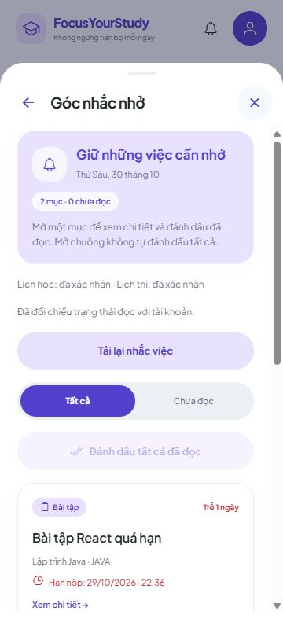
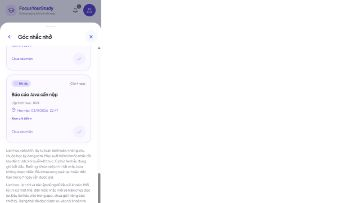

# 7B.3 — Nghiệm thu vòng đời thông báo trên web

Ngày 30/10/2026. **7B hoàn tất trong phạm vi lưu/đồng bộ trạng thái đã đọc của thông báo trong app trên web.** Push, quyền hệ điều hành, giờ yên lặng và điện thoại thật vẫn ở checklist riêng.

## Thay đổi

Khi hoàn thành/xóa nguồn hoặc đổi nội dung/mốc nhắc, dòng kết quả của lượt đọc trước được xóa. Ví dụ đã đọc 5/5, sau đó hoàn thành một bài thì không còn hiện kết quả 5/5 cạnh danh sách 4 mục. Khi bắt đầu đối chiếu lại cũng bỏ kết quả thành công cũ.

Vẫn giữ thông báo chưa xác nhận/đã lưu một phần và khóa ghi sau lỗi; thay đổi nguồn hoặc lần đọc tự động không được tự bỏ khóa này. Chỉ đối chiếu thủ công thành công mới cho thao tác tiếp. Không thay API, database, dependency hoặc công thức nghiệp vụ.

## Kết quả với UI, API và PostgreSQL thật

Hai tài khoản và schema QA riêng; ban đầu hai bài, một buổi học, hai lịch thi. Một lịch thi dùng để quan sát mốc 10 phút → đúng giờ bắt đầu bằng thời gian thật, không chỉnh giờ máy.

| Tình huống | Thao tác và kết quả quan sát |
| --- | --- |
| Đọc ban đầu | UI: 5 mục/5 chưa đọc → đánh dấu tất cả → 5/0. |
| Hoàn thành bài | UI mở chi tiết và chọn Hoàn thành: 4/0; Dashboard 1/2, 50%. Các biên nhận còn lại giữ nguyên. |
| Mở lại bài | API đổi về TODO, UI tải lại: bài trở lại chưa đọc. |
| Mốc thi mới | Lịch thi đã đọc ở mốc 10 phút tự chuyển thành chưa đọc ở mốc 0; một thẻ, không nhân đôi. Cùng lúc mở lại bài: tổng 5/2. |
| Nghỉ một buổi | UI chọn Nghỉ buổi này và lưu: lời nhắc học mất, tổng 4/2; lịch vẫn có cờ Đã nghỉ. |
| Khôi phục lịch gốc | API khôi phục, UI tải lại: 5/2. Nội dung đúng bản gốc đã đọc thì giữ đọc. |
| Đổi phòng một buổi | API đổi sang QA-B303, UI thấy phòng/lý do mới và cần đọc lại: 5/3. Đọc tất cả → 5/0. |
| Khôi phục sau khi đã đọc bản đổi | API khôi phục: bản gốc khác biên nhận gần nhất nên chưa đọc. Biên nhận không phải lịch sử mọi phiên bản. |
| Đổi giờ chuỗi | API đổi 23:12–23:57 → 23:02–23:47, UI tải lại thấy đúng giờ, 5/1. |
| Đổi phòng thi | UI đổi A101 → QA-THI-C404 và lưu: thông báo cập nhật, cần đọc lại; cùng buổi học chưa đọc thành 5/2. |
| Tắt nhắc thi | UI chọn Không nhắc và lưu: thẻ thi mất, 4/1. Tab thứ hai tải lại khớp. |
| Bật nhắc, đổi giờ thi | API bật nhắc rồi dời 5 phút; UI thấy 00:42–01:42 và cần đọc lại. |
| Hai tab sửa/đọc | B giữ danh sách; A sửa ghi chú bài qua UI; B thao tác đọc sau đồng bộ nguồn và ghi thành công. Tình huống này không được gọi là đã tái hiện 409. |
| Xung đột đúng lúc ghi | Proxy QA đổi deadline qua API ngay trước khi chuyển tiếp PUT đọc của UI: backend trả 409. UI hiện Chưa xác nhận trạng thái đọc, nội dung đã thay đổi, khóa nút ghi; tải lại nhận hạn mới và vẫn chưa đọc. |
| Mất phản hồi sau commit | Proxy QA nhận 200 từ backend rồi ngắt phản hồi tới UI. API độc lập xác nhận đã lưu; UI timeout, hiện chưa xác nhận kết quả và khóa ghi. Audit chỉ có một PUT của tình huống này, không tự gửi lại. |
| Khôi phục đường truyền | Bộ proxy gây lỗi làm vài lượt đọc tiếp theo timeout; có thử tải lại thủ công, sau đó dừng proxy và chạy backend trực tiếp. F5 khôi phục cùng tài khoản/schema: 5/2, giữ biên nhận đã commit. Đọc 2 mục còn lại → 5/0. Không kết luận lượt retry đầu tiên qua proxy đã thành công. |
| Xóa nguồn | Xóa lần lượt bằng API và đối chiếu UI: bài 5→4, chuỗi 4→3, thi 3→2; cả ba nguồn unavailable; các mục còn lại giữ đã đọc. Dòng kết quả đọc cũ không còn. |
| F5/hai tab | Cả hai tab cùng 2/0 sau ba lượt xóa, không có mục cũ. |
| Tài khoản A→B→A | B trống 0/0, không có bài của A; trở lại A còn 2/0. Lọc Chưa đọc báo đã đọc hết; Tất cả vẫn có 2 thẻ. |
| Kích thước | 320/360/430px không tràn ngang; có kiểm tra desktop và trạng thái lỗi ở 360px. |

Khôi phục cùng nội dung không luôn tạo lời nhắc mới: lịch học dùng revision theo nội dung thực tế của ngày đó. Mỗi nguồn/ngày chỉ giữ một biên nhận gần nhất. Xem hợp đồng [trạng thái đọc](../backend/docs/NOTIFICATION-READ-STATES.md).

Các thay đổi nguồn ghi rõ API trong bảng được thực hiện qua API, sau đó kiểm chứng trên UI; không gọi chúng là thao tác sửa/xóa trực tiếp trên UI. Bộ proxy chỉ nằm trong `.local` bị Git bỏ qua, không đưa vào ứng dụng/backend. Đã dọn tab, server, web, proxy và schema QA; giữ PostgreSQL và dữ liệu người dùng.





[Ảnh trạng thái chưa xác nhận sau mất phản hồi](images/notification-lost-response-360.jpg)

## Kiểm tra tự động

- TypeScript đạt; **630 test frontend đạt, 0 lỗi/bỏ qua**, gồm 4 test mới về kết quả cũ khi nguồn đổi, kết quả đối chiếu cũ, lượt đọc đang tải và giữ khóa/thông báo sau mất phản hồi.
- **42 test backend liên quan đạt, 0 lỗi/bỏ qua**: NotificationReadIntegration 40, migration 1, restart 1. Không chạy toàn bộ backend.
- Lượt Maven verify đầu qua test nhưng đóng gói lỗi vì JAR đang được server QA giữ. Dừng đúng server QA, chạy lại `mvnw.cmd -B -ntp -DskipTests verify`: đóng gói thành công. Lượt đóng gói sau không chạy lại test; số 42 là kết quả lượt trước.
- Export web QA và export bình thường đạt. Bản bình thường không chứa endpoint QA.
- `git diff --check` đạt. Chưa commit/push.

## Bạn kiểm tra nhanh

Dùng tài khoản có dữ liệu thử của bạn; không cần tạo lại database. Giữ backend và frontend chạy như các đợt trước. Tải lại frontend để nhận bản mới.

1. Tạo bài chưa hoàn thành, hạn ngày mai, tên `TEST 7B3`. Mở chuông, chờ xác nhận rồi đánh dấu đã đọc.
2. Mở bài → chọn Hoàn thành → Quay lại: bài mất khỏi chuông. Dashboard tăng số bài hoàn thành. Tìm bài ở danh sách Bài tập, đổi lại Chưa làm: lời nhắc trở lại chưa đọc.
3. Sửa deadline, lưu, mở chuông/tải lại: phải thấy hạn mới và cần đọc lại. Dòng kết quả lượt đọc cũ không còn khi nguồn đổi.
4. Với một buổi học gần đến mốc nhắc: nghỉ đúng ngày → lời nhắc mất; khôi phục → trở lại. Đổi phòng/giờ → thẻ cập nhật và cần đọc lại. Các ngày khác giữ nguyên. Một chuỗi bị xóa không còn lời nhắc của chuỗi đó.
5. Với lịch thi đã đến mốc nhắc: đổi phòng/giờ rồi lưu → thẻ đổi; chọn Không nhắc → thẻ mất. Bật lại trong Lịch học → Kỳ thi để kiểm tra lại. Đến mốc nhắc tiếp theo, kỳ thi vẫn một thẻ nhưng cần đọc lại.
6. Mở thêm tab bằng đúng URL frontend, cùng host/cổng, cùng tài khoản. Đọc ở A, B cập nhật khi nhận tín hiệu/trở lại foreground hoặc lượt đọc định kỳ. F5 vẫn giữ. Nếu nội dung đổi đúng lúc ghi và app yêu cầu tải lại, bấm Tải lại nhắc việc rồi đọc bản mới.
7. Khi mất mạng/backend tắt, phải có lỗi/chưa xác nhận, không báo đã đọc thành công. Sau khi kết nối phục hồi, tải lại để đối chiếu server đã lưu hay chưa; không bấm gửi liên tục.
8. Chuyển tài khoản trống: chuông 0, không có dữ liệu tài khoản trước. Đăng nhập lại vẫn giữ biên nhận đã lưu.

Không cần tự tái tạo race/lost response bằng proxy. Đó là phép thử QA có kiểm soát; phần sử dụng hằng ngày chỉ cần kiểm tra các bước 1–8.

## Git

```powershell
cd 'D:\Video OBS\QuanLyHocTap'
git add .
git commit -m "Hoàn tất kiểm tra và đồng bộ thông báo trên web"
git push origin main
```
