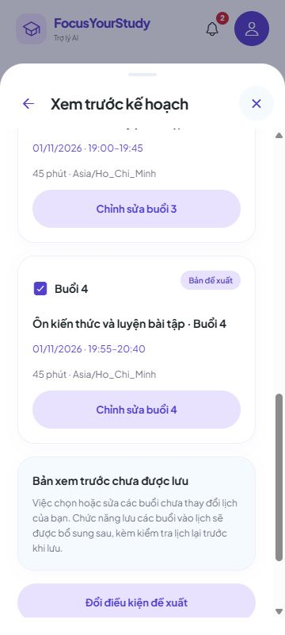
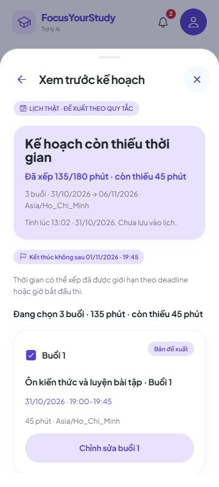

# 8A.2 — Xem và chỉnh đề xuất kế hoạch từ lịch thật

Đã nối **Trợ lý AI → Tìm lịch trống / Tạo lộ trình / Xem kế hoạch** với POST `/api/v1/study-plans/preview` cho tài khoản đăng nhập. Dùng môn/bài tập/kỳ thi thật của tài khoản, chọn ngày và giờ bằng bộ chọn hiện có. Bài còn hạn được ưu tiên mặc định. Khách chưa đăng nhập vẫn có luồng mẫu riêng.

Đây là bộ xếp lịch `RULE_BASED_V1`, chưa gọi dịch vụ AI. Xem trước, bỏ chọn và chỉnh buổi **không ghi buổi học vào PostgreSQL**. Không có nút lưu giả hoặc chuỗi POST tự học tự động. Duyệt/lưu nhiều buổi, kiểm tra lại toàn bộ lịch lúc ghi và chống tạo trùng còn ở **8A.3**.

## Những gì có thể thử

- Chọn môn, mục tiêu **Bài tập / Kỳ thi / Tự học**; bài/thi phải thuộc môn đã chọn. Bài đã hoàn thành không được chọn. Mục tiêu quá hạn được backend từ chối bằng thông báo rõ ràng.
- Chọn từ/đến ngày, giờ rảnh, các thứ trong tuần, tổng phút muốn học **thêm**, thời lượng buổi và nghỉ. Mặc định múi giờ hồ sơ, thường là `Asia/Ho_Chi_Minh`; có thể nhập múi giờ IANA khác. Tối đa 14 ngày, tổng 1440 phút.
- Xem số phút xếp được/còn thiếu, các buổi theo đúng múi giờ, mốc tính và giới hạn deadline. Có trạng thái không tìm được khoảng phù hợp.
- Bỏ chọn một buổi cập nhật tổng phút đang chọn. Mở **Chỉnh sửa buổi N** để đổi tên/ngày/giờ/thời lượng; kiểm tra giờ quá khứ, khung rảnh/thứ, deadline, chồng lấn và nghỉ giữa các buổi đang chọn.
- Bản sửa hiển thị cảnh báo: **chưa kiểm tra lại với toàn bộ lịch bận**. Tổng xếp được là kết quả gốc; tổng đang chọn là bản bạn đang chỉnh, không thay nhau.
- Đang tải ngăn gửi trùng. Đổi điều kiện hủy lượt cũ; lỗi giữ form để thử lại. Khi danh mục cũng lỗi do mất mạng, dùng **Tải lại danh mục** trước. Không tự gửi lại yêu cầu đề xuất sau lỗi.
- Đổi tài khoản xóa kết quả/yêu cầu cũ. Danh mục hoặc mục tiêu đổi sẽ có cảnh báo khi phát hiện; không tự áp dụng hoặc ghi đè bản đang xem.

**Bản nháp chỉ ở bộ nhớ màn hình.** Đóng/bỏ thay đổi, tải lại trang hoặc đổi tài khoản sẽ không giữ đề xuất. Đây chưa phải kế hoạch được lưu; không dùng Git để sao lưu dữ liệu học tập trong PostgreSQL.

## Mở app trên web

Giữ backend đang chạy ở cổng 8080. Nếu chưa mở, chạy trong terminal CMD hoặc PowerShell:

```text
powershell.exe -NoProfile -File "D:\Video OBS\QuanLyHocTap\backend\scripts\Run-Local.ps1"
```

Mở terminal thứ hai tại thư mục `D:\Video OBS\QuanLyHocTap`, chạy:

```text
npx expo start --web --port 8092
```

Mở `http://localhost:8092`, đăng nhập tài khoản đã có môn học. Trang `http://localhost:8080/api/v1/health` chỉ kiểm tra backend/database; phần giao diện nằm ở cổng 8092. Không chạy server hoặc URL QA ghi trong biên bản bên dưới.

## Kiểm tra một vòng

1. Vào **Trợ lý AI → Tìm lịch trống**, chọn môn của bạn và mục tiêu **Tự học**. Chọn vài ngày còn trống, rảnh 19:00–21:00, tổng 180 phút, mỗi buổi 45 phút, nghỉ 10 phút. Bấm **Tạo đề xuất**. Nếu hai tối hoàn toàn trống sẽ có bốn buổi: 19:00–19:45 và 19:55–20:40 mỗi tối. Lịch bận thực tế có thể làm kết quả khác hoặc thiếu thời gian.
2. Bỏ chọn một buổi 45 phút: phần **Đang chọn** giảm 45, phần còn thiếu tăng 45. Kết quả gốc phía trên vẫn giữ số phút backend đã xếp.
3. Mở **Chỉnh sửa buổi 1**. Thử nhập thời lượng 241: hiện lỗi 1–240 phút. Đổi giờ để chồng buổi khác: cả các buổi liên quan báo cần xem lại. Đóng khi đang sửa sẽ hỏi có bỏ thay đổi không.
4. Bấm **Đổi điều kiện đề xuất**, chọn **Bài tập** và bài còn hạn. Kế hoạch không được kết thúc sau hạn nộp. Thử tổng thời gian lớn hoặc hạn gần để thấy số phút còn thiếu. Chọn bài đã quá hạn sẽ hiện lỗi, không tạo buổi nào.
5. Chọn **Kỳ thi**, chọn lịch thi thật của môn. Kiểm tra ngày/giờ phòng hiển thị và mốc kết thúc không sau giờ bắt đầu thi. Mục tiêu **Tự học** không bắt buộc liên kết bài/thi.
6. Với khung rảnh chỉ hai giờ, thử tổng 180 phút và mỗi buổi 240 phút: không có khoảng nào chứa được phần 180 phút còn lại, nên kết quả là 0/180 và hướng dẫn đổi điều kiện. Đổi lại 45 phút để tiếp tục.
7. **Xem danh sách tự học**: không có buổi mới được lưu chỉ nhờ xem/chỉnh đề xuất. Đăng nhập tài khoản khác: không thấy môn hoặc đề xuất của tài khoản trước. Quay lại tài khoản ban đầu có danh mục cũ nhưng phải tạo đề xuất lại.

Muốn thử lỗi mạng, chỉ dừng backend do chính bạn đang chạy, bấm tạo đề xuất rồi khởi động lại. Form phải giữ điều kiện. Nếu xuất hiện **Tải lại danh mục**, bấm nút đó rồi **Thử tạo lại đề xuất**. Không cần xóa database.

## Biên bản kiểm tra ngày 31/10/2026

- **TypeScript đạt; 665 tests frontend đạt, không lỗi/bỏ qua — 35 mới.** Nhóm mới kiểm tra hợp đồng input/response, nanosecond từ Java, múi giờ/DST, phản hồi sai, POST/Bearer/danh sách field, lỗi không tự thử lại, quản lý yêu cầu cũ/đổi chủ sở hữu, bản nháp, chọn/bỏ chọn, deadline, chồng lấn lồng nhau.
- Export web QA và export bình thường đạt. Bản bình thường đã kiểm tra không chứa endpoint QA. Không đổi dependency, backend, migration hoặc quy chế điểm. **Không chạy lại toàn bộ backend trong đợt này**; 804 tests backend/Maven verify/đóng gói là kết quả của 8A.1.
- UI/API/PostgreSQL thật trên schema QA riêng, hai tài khoản thử, host loopback riêng; không dùng tài khoản/dữ liệu người dùng. UI: tự học 4 buổi/180 phút, giờ Việt Nam, bỏ chọn còn 135, sửa 241 phút báo lỗi, bộ chọn giờ đổi 19:30 báo trùng, xác nhận bỏ thay đổi; form giữ khi quay lại.
- UI bài tập: deadline 01/11 lúc 19:45 trả **135/180 phút, thiếu 45**. Bài quá hạn hiện lỗi nghiệp vụ, giữ form. UI kỳ thi đọc bản ghi thật, mốc 03/11 lúc 20:00. Phiên 240 phút trong khung hai giờ trả 0/180 và trạng thái trống.
- Dừng/khởi động lại **server QA riêng**: lỗi kết nối giữ form; tải lại danh mục rồi thử lại thành công. Tạo ca học 19:00–20:00 cho **môn khác qua API QA**, đề xuất React mới bắt đầu **20:00–20:45**; lịch bận toàn tài khoản được phản ánh trên UI. Đây là chuẩn bị dữ liệu qua API, không gọi là thao tác thêm ca qua giao diện.
- Đổi A→B kiểm tra màn cần thêm môn/nút tạo vô hiệu hóa và không lộ bài/môn A; quay A kiểm tra lại danh mục và form mới. Kiểm tra chiều rộng 320/360/430px không tràn ngang; ảnh ở 360px. Chưa kiểm tra điện thoại thật/Expo Go SDK khác/chạy nền trong đợt này.
- GET API sau nhiều lần xem/sửa vẫn **0 buổi tự học được lưu ở A và B**, B có 0 môn. Số liệu công khai trong [planning-preview-8a2.json](test-results/planning-preview-8a2.json); không kèm token/mật khẩu. Dịch vụ/schema QA được dọn sau kiểm tra, backend người dùng được giữ nguyên.
- Phản hồi đến muộn, abort và cô lập chủ sở hữu được kiểm tra ở **Manager/unit test**; không gọi các phép thử đó là mô phỏng hết mọi sự cố mạng trên điện thoại.





## Việc tiếp theo

**8A.3:** API duyệt/lưu nhiều buổi có xác thực owner/version, kiểm tra lịch/deadline tại thời điểm ghi, lưu nguyên khối và khóa chống tạo trùng sau mất phản hồi; nối nút duyệt thật và nghiệm thu liên thông. Chưa đánh dấu toàn bộ chức năng kế hoạch hoàn tất. Phạm vi upload/tóm tắt PDF/trắc nghiệm từ tài liệu vẫn đã bỏ, không khôi phục ở đợt này.

Tên commit: **Kết nối giao diện đề xuất kế hoạch học với backend**. Chưa tự commit/push.
