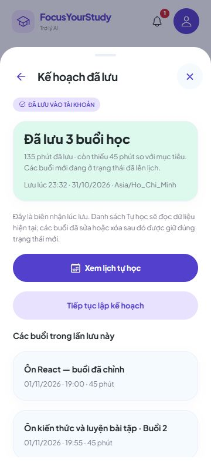
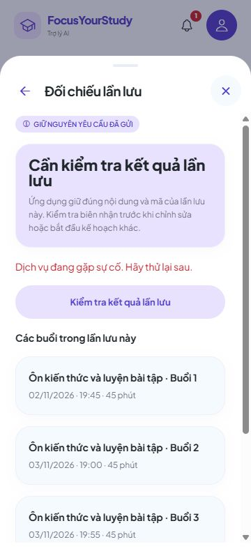
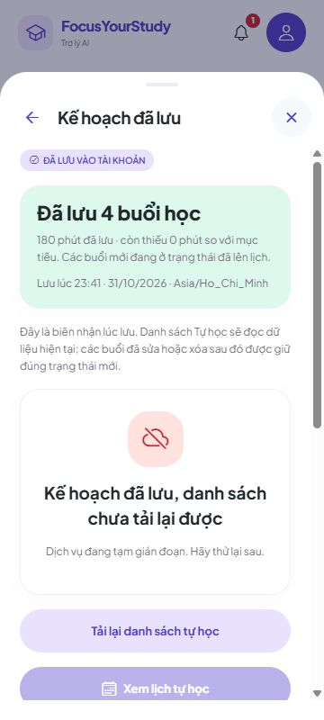

# 8A.3B — Duyệt và lưu kế hoạch trên giao diện

Đăng nhập → **Trợ lý AI → Xem kế hoạch / Tạo lộ trình / Tìm lịch trống** → tạo đề xuất → chỉnh/bỏ chọn → **Lưu các buổi đã chọn**. Backend kiểm tra lại lịch/deadline/version và ghi nguyên khối bằng API 8A.3A. Khách chưa đăng nhập vẫn dùng luồng mẫu riêng.

## Hành vi đã nối

- Chỉ gửi các buổi đang chọn, gồm tên/ngày giờ/thời lượng đã chỉnh. Nút lưu bị khóa nếu không chọn buổi nào, vượt tổng phút, có lỗi ngày/giờ/deadline/nghỉ/chồng lấn hoặc phát hiện nguồn đã đổi. Bấm lưu kiểm tra lại thời điểm hiện tại; kết quả kiểm tra cục bộ không thay thế backend.
- Giữ **mã và đúng nội dung yêu cầu trước khi POST**. Bấm hai lần trong lúc lưu không tạo hai yêu cầu. Không tự thử lại sau lỗi mạng, timeout hoặc 5xx. Cơ chế phiên hiện có có thể làm mới token sau 401, vốn bị từ chối trước khi ghi nghiệp vụ.
- Thành công hiển thị số buổi, phút đã lưu, phần còn thiếu và thời điểm lưu. Các buổi mới là đã lên lịch, không tự hoàn thành bài hoặc Pomodoro. Biên nhận được kiểm tra khớp mã/môn/mục tiêu/version/từng dòng/tổng phút trước khi xác nhận.
- **Xem lịch tự học** đọc danh sách hiện tại rồi mở đúng ngày của buổi đầu tiên vừa lưu, theo ngày hiển thị của danh sách. Không chèn ảnh chụp biên nhận vào store thay cho GET nên không khôi phục buổi đã bị sửa/xóa.
- Nếu ghi thành công nhưng GET danh sách lỗi, vẫn hiện **đã lưu**, có nút tải lại danh sách; không báo cả giao dịch thất bại và không bật nút lưu thêm.
- Nếu nguồn đổi/trùng lịch bị từ chối rõ ràng ngay lần đầu, giữ bản đang xem để quay lại chỉnh. Cảnh báo nguồn cũ chặn lưu cho tới khi đọc dữ liệu và tạo lại đề xuất. Không tự thay version để ép lưu.
- Lần lưu chưa rõ kết quả có màn riêng với các buổi đã gửi và mã đối chiếu. **Kiểm tra kết quả lần lưu** chỉ GET biên nhận. Nếu tìm thấy thì xác nhận thành công, không POST thêm. Nếu 404, vẫn giữ yêu cầu; chỉ có nút người dùng chủ động **Gửi lại đúng yêu cầu cũ**, dùng cùng body/key.
- Chỉ đóng biên nhận đã xác nhận hoặc lần từ chối rõ ràng sau khi xóa được thông tin đối chiếu cục bộ. Nếu kho lưu trữ lỗi, không âm thầm quên mã rồi cho tạo lần lưu khác. Đổi tài khoản/đóng màn hình chặn phản hồi cũ cập nhật UI mới.

## Lưu thông tin đối chiếu ở đâu

Trên **web**, dùng sessionStorage theo **tab + endpoint backend + tài khoản**. Giữ qua F5/đăng nhập lại trong cùng tab; tab khác có phạm vi độc lập. Đóng tab hoặc xóa dữ liệu duyệt có thể mất mã; không coi đây là sao lưu qua mọi trình duyệt/thiết bị.

Trên **native**, dùng SecureStore đang có, theo endpoint/tài khoản. Chia dữ liệu thành các phần nhỏ và chỉ công bố manifest sau khi ghi đủ, tránh giới hạn giá trị lớn của một số thiết bị. Lỗi ghi không gửi POST. Tham chiếu [SecureStore SDK 56](https://docs.expo.dev/versions/v56.0.0/sdk/securestore/). Đợt này kiểm tra codec/kho mô phỏng bằng test, **chưa nghiệm thu trên điện thoại thật**.

Không lưu token/mật khẩu trong bản đối chiếu. Dữ liệu giữ là **các buổi đã chọn gửi lưu**, không phải toàn bộ những buổi đã bỏ chọn hoặc mọi bản nhập còn dang dở trước khi bấm lưu.

Nếu một lần đã lỗi mạng rồi lần gửi lại cũng gặp lỗi, app tiếp tục giữ mã/body để đối chiếu. Không dùng riêng một GET 404 làm bằng chứng lần trước chắc chắn chưa ghi, không tự xóa yêu cầu hoặc tạo mã mới. Có thể đóng màn và xem dữ liệu Tự học hiện tại; thông tin đối chiếu vẫn giữ khi mở lại cùng tab/tài khoản.

## Mở để thử

Backend cần bản **8A.3A/V13**. Chạy hoặc khởi động lại terminal backend:

```text
powershell.exe -NoProfile -File "D:\Video OBS\QuanLyHocTap\backend\scripts\Run-Local.ps1"
```

Giữ terminal đó chạy. Ở terminal khác, tại thư mục `D:\Video OBS\QuanLyHocTap`:

```text
npx expo start --web --port 8092
```

Mở `http://localhost:8092`, đăng nhập tài khoản có môn học. Health cổng 8080 chỉ kiểm tra backend/database, không phải giao diện app. Không chạy host/cổng QA bên dưới để dùng dữ liệu của bạn.

## Kiểm tra một vòng trên app

1. Trợ lý AI → **Tìm lịch trống**. Chọn môn, mục tiêu tự học hoặc bài còn hạn, ngày/giờ rảnh và 180 phút, mỗi buổi 45 phút, nghỉ 10 phút. Nếu lịch đủ trống sẽ có 4 buổi; kết quả phụ thuộc giờ hiện tại và lịch thật.
2. Bỏ chọn một buổi: phần đang chọn còn 135 phút. Mở **Chỉnh sửa buổi 1**, đổi tên. Nhập 241 phút: nút lưu phải bị khóa. Đổi về 45 phút, xử lý các lỗi khác nếu có.
3. Bấm **Lưu các buổi đã chọn**. Chờ biên nhận: 3 buổi/135 phút đã lưu, còn thiếu 45 phút. Không có nghĩa đã học xong 135 phút.
4. Có thể F5 trước khi đóng biên nhận; vào lại Trợ lý → Xem kế hoạch để thấy biên nhận cũ. App không tự gửi POST nữa. Bấm **Xem lịch tự học**, kiểm tra đúng tên/giờ và ngày đã lưu. Tải lại app vẫn còn dữ liệu.
5. Muốn lập kế hoạch tiếp, chọn **Tiếp tục lập kế hoạch**. App đóng lần lưu cũ, quay về điều kiện và cần tạo đề xuất mới. Lịch đã lưu được tính là bận cho lượt sau.
6. Khi gặp lỗi chưa rõ kết quả, mở lại màn kế hoạch → **Kiểm tra kết quả lần lưu** trước. Không bấm tạo kế hoạch khác để thay cho lần chưa rõ. Đối chiếu không tạo thêm buổi; nếu có nút gửi lại thì nó vẫn dùng mã/nội dung cũ.
7. Nếu báo môn/bài/thi đã đổi, quay lại bản đang xem → **Tải lại danh mục → Đổi điều kiện đề xuất → Tạo đề xuất**, xem lại các buổi rồi mới duyệt. App không tự thay thế bản bạn đã xem.

Thử lỗi mạng nên dùng tài khoản thử và theo dõi dữ liệu thật. Đóng màn trong lúc đang lưu **không hủy được giao dịch đang xử lý**; mở lại để đối chiếu. Không xóa database hoặc kho đối chiếu để giải quyết một kết quả chưa rõ.

## Biên bản kiểm tra web

- **TypeScript, 702 tests frontend (37 mới) và export web QA/bình thường đạt**, không lỗi/bỏ qua. Kiểm tra bản bình thường không có endpoint QA. Không đổi backend/schema/dependency, không chạy lại full backend trong đợt này; 844 tests backend là kết quả 8A.3A.
- 37 test mới: xây body từ buổi chọn/chỉnh, chặn bản sai, kiểm tra biên nhận theo từng dòng/target/version/tổng/phút chính xác; POST/GET/Bearer, không tự thử lại sau lỗi, lưu bền trước POST, hai lần bấm, abort/đổi owner, khôi phục sau remount, GET 404 không tự coi là thất bại, kho lưu trữ lỗi, manifest/chunk Unicode nhỏ hơn 2KB và thế hệ ghi dở. Các test kho native dùng bộ nhớ mô phỏng, không gọi là nghiệm thu thiết bị.
- UI/API/PostgreSQL QA riêng: sửa tên buổi 1, bỏ chọn buổi 4, lưu **3 buổi/135 phút**; nhập 241 khóa nút lưu. F5 giữ biên nhận cũ và không POST thêm. Danh sách thật giữ tên đã chỉnh.
- Bộ proxy QA trả **503 sau khi backend đã trả 201 và commit** để mô phỏng mất xác nhận. UI giữ nguyên key/body, F5 và A→B→A vẫn mở đúng yêu cầu cũ; B trống không thấy A. GET đối chiếu tìm được biên nhận, số dòng vẫn **7**, không tạo thêm buổi. Đây là lỗi phản hồi có kiểm soát, không tuyên bố là thử mọi kiểu mất gói mạng.
- Bộ QA sửa bài qua API ngay trước khi forward Apply: backend 409 SOURCE_CHANGED, giữ bản duyệt; quay lại thấy cảnh báo/nút lưu bị khóa. Tải danh mục và tạo lại đề xuất dùng version mới thì lưu được. Nhóm bị từ chối không làm số dòng tăng (vẫn 7).
- Lượt tiếp theo lưu thành công bốn buổi nhưng GET tự học bị proxy trả 503: UI vẫn hiển thị đã lưu, có tải lại danh sách, không bật lưu lần nữa. Đọc lại sau khi bỏ lỗi thành công; tổng **11 dòng, 495 phút**, tất cả PLANNED và ID không trùng; B có 0 dòng. Các POST Apply phía backend là **201, 201, 409, 201**.
- Nút Xem lịch tự học mở đúng ngày có buổi đầu tiên đã lưu (02/11 rồi 04/11 trong dữ liệu QA), đóng luồng cũ; không mở ngày hôm nay trống. Kiểm tra 320/360/430px không tràn ngang; ảnh ở 360px.
- [Số liệu kiểm tra](test-results/study-plan-save-8a3b.json) không chứa credential. Đã dọn schema/server/proxy/tab QA và tệp credential riêng, giữ database dùng chung. Không seed/reset dữ liệu người dùng.
- UI đã kiểm tra các đường đi chính trên web. Timeout/404 rồi gửi lại/ghi cục bộ dở/đến muộn và thế hệ native được kiểm tra ở Manager/adapter/unit test; chưa thử điện thoại thật, nền hoặc mọi tình huống đa tab. 8A.3C vẫn để riêng.







8A.3B hoàn tất phần nối giao diện trong phạm vi trên. **8A.3C** vẫn là đợt nghiệm thu liên thông rộng hơn; native/thiết bị thật và những phần đã hoãn vẫn chưa đánh dấu hoàn tất. Phạm vi upload/PDF/trắc nghiệm từ tài liệu không được khôi phục.

Tên commit: **Kết nối duyệt và lưu kế hoạch học trên giao diện**. Chưa tự commit/push.
