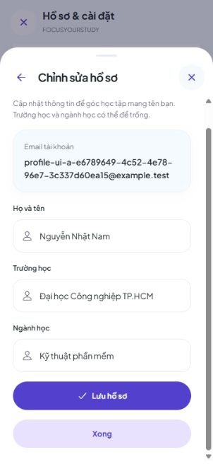
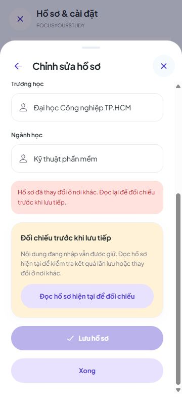

# 9A.2 — Sửa hồ sơ tài khoản trên app

Hồ sơ đã nối GET/PUT `/api/v1/users/me`: sửa họ tên, trường và ngành, lưu vào tài khoản PostgreSQL. Email chỉ đọc. Không đổi backend, migration hoặc dependency trong đợt này; cần backend 9A.1 đang chạy.

## Chạy và kiểm tra thông thường

Giữ hai terminal mở. Terminal backend:

```powershell
cd 'D:\Video OBS\QuanLyHocTap\backend'
powershell.exe -NoProfile -File "D:\Video OBS\QuanLyHocTap\backend\scripts\Run-Local.ps1"
```

Terminal frontend:

```powershell
cd 'D:\Video OBS\QuanLyHocTap\frontend'
npx expo start --web --port 8092
```

1. Mở địa chỉ web Expo hiện trong terminal; đăng nhập tài khoản đã đăng ký.
2. Bấm biểu tượng tài khoản → **Hồ sơ → Chỉnh sửa hồ sơ**. App đọc bản mới trước khi cho sửa.
3. Đổi họ tên, trường, ngành rồi bấm **Lưu hồ sơ**. Thành công có thông báo xanh; tên trên thẻ tài khoản cập nhật ngay. Không làm mất lựa chọn học kỳ hoặc dữ liệu học tập đang xem.
4. Bấm **Xong**, F5, mở Hồ sơ lại: vẫn là nội dung vừa lưu. Đăng xuất rồi đăng nhập lại cũng phải giữ đúng tài khoản.
5. Thử xóa hết họ tên rồi Lưu: báo lỗi dưới ô, không gửi PUT. Họ tên sau bỏ khoảng trắng dài 1–60 ký tự; trường/ngành có thể trống, tối đa 100 ký tự mỗi ô.
6. Sửa một ô rồi bấm ×/quay lại: có cảnh báo bản nháp. **Tiếp tục chỉnh sửa** giữ nội dung; **Bỏ thay đổi** trở về hồ sơ đã xác nhận.

Bản nháp chỉ ở bộ nhớ: bỏ thay đổi, tải lại trang hoặc đổi tài khoản sẽ mất bản chưa lưu. Cảnh báo tải lại/đóng trang dùng cơ chế trình duyệt, có thể khác giữa trình duyệt. Đóng form khi đang gửi không thể hủy một thay đổi server đã ghi; mở lại để đọc kết quả hiện tại.

## Test hai tab, tránh ghi đè

1. Mở cùng địa chỉ app ở tab A và B, cùng tài khoản.
2. A mở Chỉnh sửa hồ sơ, nhập tên `Bản nháp A`, giữ nguyên form.
3. B mở Chỉnh sửa hồ sơ, đổi tên thành `Tên mới từ B` rồi lưu thành công.
4. Trở về A, bấm Lưu: báo bản cũ/409, giữ `Bản nháp A`, khóa Lưu.
5. Bấm **Đọc hồ sơ hiện tại để đối chiếu**: thấy nội dung server và bản đang nhập.
6. Chọn **Dùng thông tin hiện tại** để dùng bản B, hoặc **Giữ bản đang nhập để sửa tiếp** rồi kiểm tra và bấm Lưu chủ động. Không tự lấy version mới để ghi đè.

## Lỗi mạng hoặc chưa xác nhận được lần lưu

Form giữ nội dung và yêu cầu đọc lại; không tự gửi PUT lần nữa. Bấm **Đọc hồ sơ hiện tại để đối chiếu** khi kết nối đã ổn. Nếu server đang có đúng nội dung đã gửi, app xác nhận bằng GET; nếu khác, người dùng chọn cách tiếp tục như trên. Lỗi đọc không được coi là lưu thành công và không xóa bản nháp.

Backend cũ không có `version` vẫn có thể đọc hồ sơ, nhưng form không cho ghi. Khởi động lại backend phiên bản 9A.1 rồi tải lại. Form chỉ sửa ba trường; email, mật khẩu, avatar, múi giờ và cài đặt thuộc đợt khác.

## Kết quả kiểm tra ngày 05/11/2026

- TypeScript đạt; **738 tests frontend đạt, 24 mới**, không lỗi/bỏ qua. Bao gồm validation, single-flight, 409, mất phản hồi, đối chiếu GET, phản hồi cũ, đổi chủ và refresh token.
- Export web QA và export thông thường đều đạt với cache sạch. Bản thông thường đã kiểm tra không chứa địa chỉ proxy QA.
- Đã thao tác trực tiếp UI với API/PostgreSQL thật trong schema riêng: nhập tiếng Việt, lỗi tên trống, lưu/F5, hai tab xung đột, đọc/giữ bản nháp/lưu tiếp, cảnh báo đóng, A → B → A, và 320/360/430 px không tràn ngang.
- Proxy QA gây lỗi 503 sau khi backend đã trả 200 để kiểm tra mất xác nhận: GET đối chiếu được, không gửi PUT lần hai. Đây là một tình huống lỗi có kiểm soát, không đại diện mọi lỗi mạng.
- Sáu PUT thực tế có trạng thái `[200, 200, 409, 200, 200, 200]`; tài khoản A kết thúc version 5, B vẫn version 0. Dữ liệu tiếng Việt đọc lại đúng, B không bị thay đổi.
- Không chạy lại toàn bộ backend trong đợt frontend này. **863 tests backend** là kết quả 9A.1 trước đó. Chưa nghiệm thu điện thoại thật/native.
- Đã đóng tab, dừng backend/proxy web QA và xóa schema thử riêng; giữ PostgreSQL chung và dữ liệu người dùng. Chưa commit/push.

[Báo cáo kiểm tra](test-results/profile-ui-9a2.json). Các mục 8A.3C chưa chốt và native 2C.3B tiếp tục để riêng.






