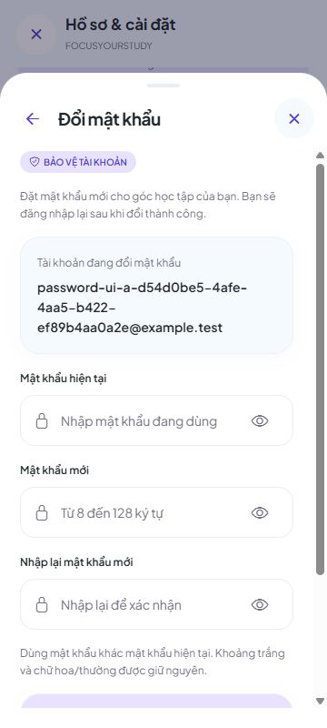
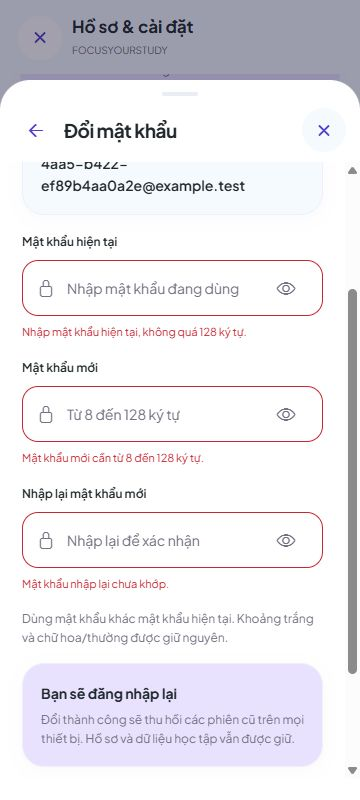

# 9B.2 — Giao diện đổi mật khẩu

Trong **Hồ sơ → Tài khoản → Đổi mật khẩu**, app có ba ô hiện tại/mới/nhập lại, nút hiện-ẩn riêng từng ô, báo lỗi và trạng thái đang gửi. Form nối PUT `/api/v1/users/me/password` của 9B.1. Không đổi backend/schema/dependency trong đợt này; backend cần đã có V14.

## Mở app

Khởi động lại backend nếu đang dùng bản trước 9B.1. Terminal thứ nhất:

```text
cd "D:\Video OBS\QuanLyHocTap\backend"
powershell.exe -NoProfile -File ".\scripts\Run-Local.ps1"
```

Giữ terminal này mở. Terminal thứ hai:

```text
cd "D:\Video OBS\QuanLyHocTap\frontend"
npx expo start --web --port 8092
```

Mở địa chỉ web Expo hiện trong terminal. Đăng nhập tài khoản thử riêng để tránh thay mật khẩu tài khoản đang dùng. Nếu chưa tải được hồ sơ, dùng **Tải lại hồ sơ** trước; nút Đổi mật khẩu xuất hiện khi xác nhận được hồ sơ tài khoản.

## Tự kiểm tra một vòng trên form

Bạn tự nhập mật khẩu mới, nhập lại và bấm nút đổi khi muốn thay thật. App sẽ thu hồi mọi phiên cũ khi thành công, dữ liệu học tập vẫn còn.

| Test | Thao tác | Kết quả đúng |
| --- | --- | --- |
| 1. Bỏ trống | Mở form, không nhập và bấm Đổi mật khẩu | Báo lỗi ba ô, không gửi PUT. |
| 2. Độ dài/trùng nhau | Mật khẩu mới dưới 8 hoặc trên 128 ký tự, hoặc giống mật khẩu hiện tại | Báo lỗi ô mật khẩu mới; chưa đổi. |
| 3. Xác nhận | Hai lần nhập mật khẩu mới không khớp | Báo lỗi nhập lại; chưa gửi PUT. |
| 4. Sai hiện tại | Mật khẩu hiện tại nhập sai, mật khẩu mới hợp lệ và nhập lại khớp | Lỗi dưới ô hiện tại; giữ form và phiên đăng nhập để sửa. |
| 5. Bản nháp | Nhập một ô rồi bấm ×/quay lại | Có cảnh báo; Tiếp tục chỉnh sửa giữ nội dung. Bỏ thay đổi rồi mở lại: các ô trống. |
| 6. Đổi thật | Nhập đúng hiện tại và mật khẩu mới hợp lệ, nhập lại khớp, tự bấm Đổi mật khẩu | Đưa về Đăng nhập, có thông báo xanh Đã đổi mật khẩu, điền sẵn email, ô mật khẩu trống. |
| 7. Mật khẩu cũ/mới | Thử đăng nhập bằng mật khẩu cũ, sau đó dùng mật khẩu mới | Cũ bị từ chối, mới vào được; học kỳ/môn/bài/điểm vẫn còn. |
| 8. Tải lại/phiên khác | F5 sau đổi nhưng trước đăng nhập lại; thử tab/thiết bị có phiên cũ | Không khôi phục được phiên cũ. Tab khác nhận ra khi đồng bộ phiên hoặc gọi API/refresh. |
| 9. Tài khoản khác | Đăng nhập B sau khi đổi A | B giữ mật khẩu/dữ liệu riêng; form không mang bản nhập của A. |

Mật khẩu giữ nguyên khoảng trắng, Unicode và chữ hoa/thường. Trường mới dùng giới hạn 8–128 như đăng ký, không thêm quy tắc phức tạp khác backend. Việc hiện mật khẩu chỉ đổi cách hiển thị ô đó.

## Nếu app chưa xác nhận được kết quả

Sau khi đã gửi, timeout/lỗi mạng/5xx/phản hồi không đúng có thể xảy ra cả khi server đã lưu. App **không gửi lại PUT**, đóng phiên trên thiết bị và mở đăng nhập với thông báo màu cảnh báo **Cần kiểm tra kết quả**, không báo thành công giả.

Khi kết nối ổn, thử đăng nhập bằng mật khẩu mới. Vào được nghĩa là thay đổi đã có hiệu lực. Nếu vẫn chưa kết nối được, kết quả còn chưa xác nhận. App có thể cần đóng phiên thử cũ trước khi login; thao tác đó chỉ logout, không đổi mật khẩu thêm lần nữa.

Đóng form sau khi gửi không hủy được thay đổi server đã ghi. App tiếp tục xử lý phản hồi dù form đã đóng; mật khẩu không được ghi vào localStorage, sessionStorage hoặc SecureStore. Bản nhập chỉ nằm trong bộ nhớ của form và bị bỏ khi đóng/đổi tài khoản. Journal chỉ lưu trạng thái phiên và ID/refresh token theo cơ chế nền tảng sẵn có; web không lưu token trong localStorage.

Trước khi gửi PUT, app ghi journal inflight để F5/khởi động lại không tự tiếp tục phiên hoặc gửi lại đổi mật khẩu sau sự cố. Nếu ghi journal lỗi, không gửi PUT. Khi đã nhận 204 nhưng dọn storage lỗi, vẫn báo kết quả server đã xác nhận, đóng phiên trong bộ nhớ và cảnh báo lỗi lưu trữ; journal cũ bảo vệ lần khôi phục tiếp theo.

## Kết quả kiểm tra 05/11/2026

- **TypeScript và 771 tests frontend đạt (33 mới), không lỗi/bỏ qua.** Có validation, payload chỉ hai trường, exact 204, single-flight, journal, đổi tài khoản, lỗi storage, refresh trước khi gửi, không deadlock, không retry PUT và phản hồi 401 nền đến trễ không xóa thông báo kết quả.
- Export web QA và export thông thường đạt với cache sạch; bundle thông thường được kiểm tra không chứa endpoint QA.
- Kiểm tra **UI trực tiếp**: đăng nhập tài khoản giả, mở form, bỏ trống, hiện/ẩn mật khẩu hiện tại, cảnh báo đóng/tiếp tục/bỏ bản nháp, mở lại trống; bố cục 320/360/430 px không tràn ngang. Đăng nhập lại sau thay đổi bằng API thấy học kỳ còn nguyên. Ảnh dưới là form và validation, không phải ảnh xác nhận đã bấm đổi thật.
- Kiểm tra **SessionManager + API frontend thật qua HTTP/PostgreSQL**, chạy từ CLI với tài khoản/schema riêng: sai mật khẩu hiện tại giữ phiên, 204 xóa phiên và giữ email/outcome, đăng nhập mới; proxy trả 503 sau backend 204 để thử mất xác nhận; app giữ outcome unconfirmed, không PUT lại và đăng nhập xác nhận bằng mật khẩu mới. Journal không chứa mật khẩu. Ba PUT phía backend có trạng thái `[400, 204, 204]`, trong đó một lần 204 bị proxy đổi thành 503 ở phản hồi tới frontend. Mật khẩu cũ bị từ chối, học kỳ và tài khoản B giữ nguyên.
- **Chưa nghiệm thu thao tác nhập mật khẩu mới → bấm đổi thật trên trình duyệt hoặc điện thoại thật.** Luồng gửi/nhận và xử lý phiên được kiểm tra tự động như trên; dùng bảng test để tự kiểm tra thao tác form. Không gọi kiểm thử Manager/API là kiểm thử UI toàn luồng.
- Không chạy lại 884 tests backend trong đợt này; đó là báo cáo tổng hợp 9B.1. Không sửa backend/migration/dependency, không nâng Expo.
- Đã reset viewport, đóng tab, dừng backend/proxy/web QA và xóa schema thử riêng; giữ PostgreSQL chung và tài khoản thật. Chưa commit/push.

[Báo cáo máy đọc](test-results/password-ui-9b2.json). Native 2C.3B, quên mật khẩu qua email và các mục hoãn vẫn để riêng.




